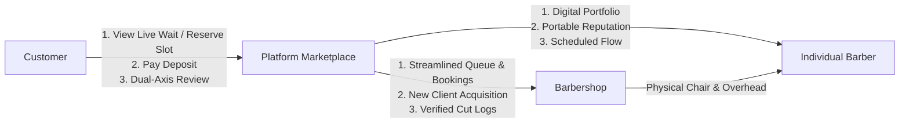
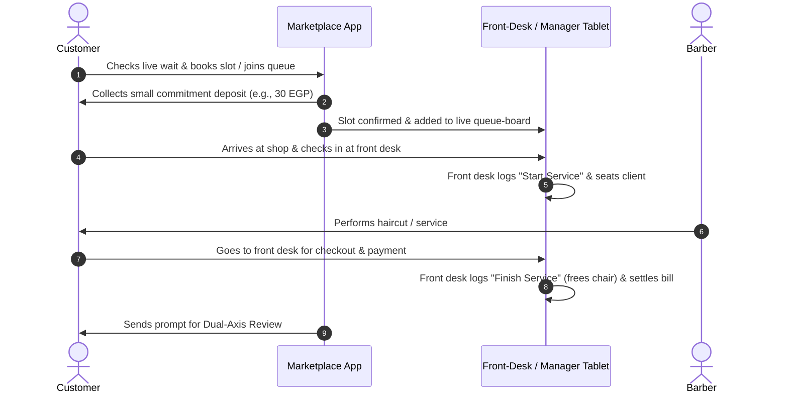

# Barber Operating System & Marketplace: Business & System Specification

---

## 1. Executive Summary
A vertical marketplace and queue-management system designed for the barber and men's grooming industry (starting in high-density urban Egypt/MENA). 

The platform solves the core industry dilemma—**wait blindness, peak bunching, and revenue lost to walk-outs**—without violating the cultural fairness of the shop floor. It pairs an internal operational tool for barbershop management (replacing manual paper registers) with a consumer discovery, live queue tracking, and booking marketplace.

---

## 2. Core Stakeholders & Value Propositions

### 1. The Barbershop (Business / Owner)
* **Value:** Replaces paper ledgers with automated operational logs, optimizes chair utilization, eliminates revenue loss from walk-away clients (~3+ clients/day), and acquires new high-intent clients via marketplace listings.
* **Control:** Owns client relationship data, approves barber associations to chairs, and configures service pricing and operational hours.
* **Interface:** Central Manager/Receptionist Tablet Dashboard + Shop Waiting Area Status Screen.

### 2. The Barber (Service Provider / Craftsman)
* **Value:** Builds a verified digital portfolio, showcases work (e.g., social transformations from TikTok/Instagram), smooths customer arrival spikes, and earns a portable professional reputation.
* **Autonomy:** Maintains a personal profile, visual portfolio, service specialty tags, and verified customer craftsmanship ratings that stay with them across career moves.
* **Interface:** Mobile App (Profile management, portfolio showcase, schedule visibility, and ratings dashboard; zero hardware interaction required while cutting).

### 3. The Customer (End-User)
* **Value:** Completely eliminates blind waiting times (30–60 minutes), allows guaranteed access to *their preferred barber*, and provides transparent pricing and verified ratings.
* **Actions:** Discovers top-rated shops/barbers, monitors live wait times in real time, joins the virtual queue remotely or reserves advance slots, and submits reviews.
* **Interface:** Consumer Web Application / iOS & Android Mobile App.

---

## 3. System Architecture & How It Works

### Step-by-Step Service Lifecycle

### A. Operational Logging & Shop Floor Mechanics
* **Centralized Front-Desk Control (Zero Barber Station Interaction):**
  * **Front Desk / Manager Tablet Only:** The receptionist or shop manager is the sole operator handling all service logs. When a client takes a seat, the front desk assigns them to the specific barber chair and taps to log the service start. When the client finishes and pays, the front desk logs the service end, releasing the chair on the live queue and reconciling the bill.
  * **Zero Friction for Barbers:** Barbers focus 100% on craftsmanship with no disruptions. They do not touch phones, tablets, or station buttons between cuts or while holding tools.
* **Automated Log Generation:** Front-desk actions automatically timestamp each service, attribute it to the specific barber, categorize it by service type (Haircut, Beard Trim, Combo, Facial), and reconcile daily volume with the cash register.

### B. The Hybrid Queue & Booking Engine
* **Virtual Queue (Remote Walk-In):** For immediate visits, customers can join the active live queue remotely from their phone, receive real-time ETA updates, and arrive exactly when their turn is approaching ("Just-In-Time" arrival).
* **Advance Time Slots with Buffer Windows:** Customers can reserve advance slots for upcoming days/hours. To keep shop operations smooth, advance slots incorporate automated dynamic buffers based on average service durations (e.g., 30 min hair, 20 min beard).
* **Shop Floor Fairness Display:** A prominent screen in the waiting area displays the live queue, scheduled upcoming slots, and current chair statuses. Physical walk-ins clearly see why a remote appointment is seated, eliminating accusations of favoritism or line-cutting.

### C. Financial Transactions & No-Show Protection
* **Commitment Deposit:** Advance reservations require a small nominal digital deposit (e.g., 20–30% or flat 30–50 EGP via InstaPay, mobile wallet, or credit/debit card).
* **Final Settlement:** The deposit is automatically credited toward the final service bill at the shop counter. The remaining balance is paid directly to the shop via cash or card.
* **No-Show / Late Policy:** If a client fails to show up within a grace window (e.g., 10 minutes past their slot), their slot is released to waiting walk-ins, and the deposit is forfeited to compensate the shop and barber for idle chair time.

### D. Portable Identity vs. Shop Ownership
* **Shop Protection:** Customer phone numbers and internal shop revenue data remain strictly private to the barbershop business.
* **Barber Portability:** A barber’s profile, skill badges, and verified customer craftsmanship ratings belong to the barber. If a barber moves to a new shop, their accumulated reputation and historical cut stats transfer with their verified identity, while their active scheduling locks to the new host shop.

### E. Review & Rating Architecture
* **Verified Cuts Only:** To prevent competitor sabotage or fraudulent bot reviews, a customer can *only* review a shop or barber after a completed, logged service ticket.
* **Dual-Axis Review Scale:**
  1. **Shop Experience (1–5 Stars):** Evaluates ambiance, hygiene/cleanliness, reception quality, waiting area comfort, and punctuality.
  2. **Barber Craftsmanship (1–5 Stars):** Evaluates cutting skill, attention to detail, fade/beard precision, and communication.

---

## 4. Monetization Model

### Primary Model: Monthly SaaS + Marketplace Booking Commission
* **Base SaaS Tier (Shop OS & Queue Software):**
  * A flat monthly subscription per active chair (e.g., **250 to 400 EGP / chair / month**) charged to the barbershop.
  * Covers the front-desk management dashboard, real-time queue synchronization, automated service logging, analytics, and the waiting-area TV display feed.
* **Marketplace Commission:**
  * A **10% to 15% transaction commission** (or fixed booking fee) charged only on client appointments originated and booked directly through the consumer marketplace app.
* **Rationale & Advantages:**
  * **Predictable Recurring Revenue:** Generates reliable monthly recurring revenue (MRR) through the SaaS component regardless of seasonal demand swings.
  * **Zero Walk-In Friction:** Because walk-in clients incur no per-cut platform fees, shop owners have zero incentive to bypass or under-report cash transactions at the front desk.
  * **Pay-for-Performance Acquisition:** The shop only pays marketing/marketplace fees when the platform delivers an incremental paying customer.

---

### Alternative Model: All-Cut Per-Service Fee (Usage-Based Micro-Fee)
* **Mechanism:** The platform charges a flat micro-fee (e.g., **5 to 10 EGP**) for **every completed cut logged in the system**, regardless of whether the client was a physical walk-in or booked via the marketplace, with zero upfront monthly SaaS fees.
* **Trade-off:** Lowers initial adoption resistance for budget-conscious shops, but creates friction around cash walk-in auditing and incentivizes off-system logging.

