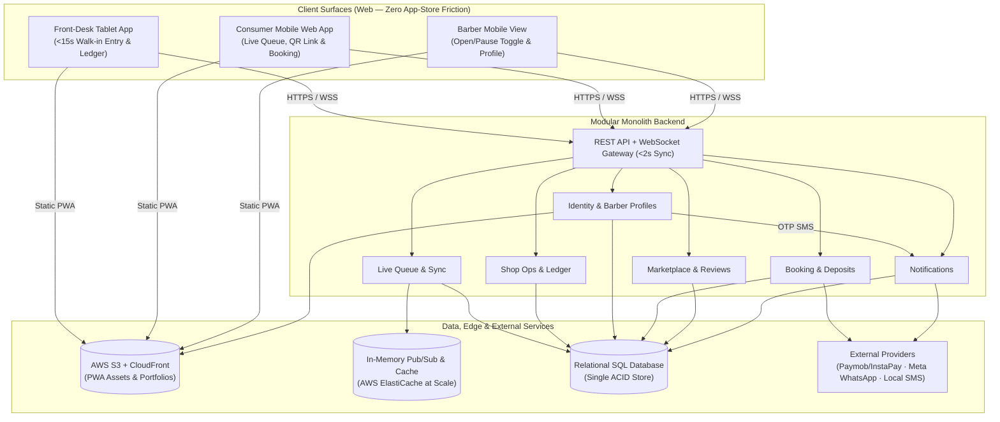

# 2.1 Architecture & Engineering Decisions

*Modeling baseline across Deliverable 2.1: **50 EGP/USD**, Cairo mid-level engineering rate of **EGP 300/hr**, and 3-year SOM growth of **24 → 68 → 154 shops** (~2,028 active shop-months; 1,860 billed SaaS invoices after a 1-month free trial across 168 newly signed shops).*

## 1. Architecture Style: Modular Monolith

**Decision:** Build the platform as a **Modular Monolith**—a single deployable backend serving three responsive Progressive Web App (PWA) views (front-desk tablet, consumer mobile web, and barber mobile) backed by one relational SQL database and `<2s` WebSocket sync.

### Justification by Team Size, Stage, and Expected Load
* **Team Size (1 Engineer):** One part-time student CTO (Abdelrahman) is shipping the MVP within a single semester. Microservices add operational overhead (service discovery, distributed tracing, multi-repo CI/CD) that would delay launch; a single codebase maximizes build, test, and deployment velocity.
* **Stage & Consistency (Pilot → Year 1):** Queue accuracy and zero double-booking are mission-critical. Keeping all writes in one relational SQL database delivers ACID transactions (row-level slot locking) without distributed-transaction complexity.
* **Expected Load (Pilot → Year 3 SOM):** Peak Cairo traffic (Thu/Fri, 6:00–11:00 PM) stays well within one modular monolith's capacity:
  * **Pilot (1–3 shops, ~15 chairs; 100 MAU):** ~15–20 peak concurrent WebSockets (WS), `<2` writes/sec.
  * **Year 1 SOM (24 shops, ~120 chairs; ~10k MAU):** ~275–525 peak WS, ~5–10 writes/sec.
  * **Year 3 SOM (154 shops, ~770 chairs; up to 100k MAU at 300 shops):** ~1,650–3,150 peak WS (~30–50 writes/sec; up to ~6k peak WS at 300 shops).

### High-Level Architecture

* **Modularity & Extraction Triggers:** Strict internal module boundaries (no cross-module direct table writes) keep domains decoupled so `Live Queue & Sync` or `Notifications` can be extracted without a rewrite—only if headcount exceeds **5+ engineers** (merge/deploy contention) or sustained concurrency exceeds **10,000+ simultaneous WS**.

---

## 2. Build vs. Buy & 3-Year Total Cost of Ownership (TCO)

Engineering bandwidth is reserved for core differentiators (live per-barber queue, `<15s` front-desk ledger, portable barber profiles). Three supporting capabilities are evaluated on a **3-year TCO** basis using AI-assisted development hour estimates:

| Capability | Build 3-Yr TCO (EGP) | Buy 3-Yr TCO (EGP) | 3-Yr Net Savings | Lock-In Risk & Mitigation | Decision |
| :--- | :---: | :---: | :---: | :--- | :---: |
| **1. Payments & Deposits** *(Paymob vs. Direct Bank/PCI)* | **1,428,480** *(105k build + 90k maint. + 1,200k PCI/CBE + 33.5k MDR)* | **76,530** *(9k integ. + 10.8k maint. + 56.7k SaaS fees; deposits pass-through)* | **1,351,950** *(95% cheaper)* | **Medium** (webhook/token format). Isolated behind a `PaymentProvider` adapter (swappable to FawryPay). | **BUY** *(Paymob)* |
| **2. Auth & Phone OTP** *(Self-Hosted Library vs. Supabase Auth)* | **50,700** *(12k build + 16.2k maint. + 22.5k SMS)* | **79,500** *(4.8k integ. + 7.2k maint. + 45k Pro + 22.5k SMS)* | **28,800** *(36% cheaper)* | **Low** (open-source auth library in our own SQL DB). Standard token/session middleware; zero DB-host lock-in. | **BUILD** *(Self-Hosted)* |
| **3. WhatsApp / SMS Alerts** *(Meta Cloud API + SMS vs. SMPP)* | **427,950** *(42k build + 43.2k maint. + 342.75k carrier)* | **217,800** *(6k integ. + 9k maint. + 202.8k msgs)* | **210,150** *(49% cheaper)* | **Low–Medium** (Meta template pricing). Isolated behind a `NotificationService` router (Web Push → WhatsApp → SMS). | **BUY** *(Meta + Local SMS)* |
| **Total (3 Capabilities)** | **1,907,130** | **373,830** | **1,562,100** *(Chosen TCO: 345,030 vs. All-Build)* | External APIs isolated via adapters; auth remains DB-portable. | **2 BUY / 1 BUILD** |

### Key Cost Drivers & Volume Basis
* **1. Payments & Deposits — BUY (Paymob):** Processes ~EGP 9.66M over 3 years (`1,860 SaaS invoices × EGP 1,000 = EGP 1.86M`; `195,000 post-Q1 deposits × EGP 40 = EGP 7.80M`). Platform bears only SaaS card fees (`2.75% + EGP 3 = EGP 30.50/invoice → EGP 56,730`) plus 66h engineering; customer deposit fees (`~3%` / EGP 1.20 via mobile wallet/InstaPay/Meeza) are deducted from shop settlements via Paymob Split (**EGP 0 platform COGS**). Building directly requires 650h engineering plus an **EGP 1.20M** PCI-DSS/CBE compliance floor (`EGP 400k/yr × 3`).
* **2. Auth & Phone OTP — BUILD (Self-Hosted Library):** Live-queue viewing requires zero login; only account-bound actions (alerts, deposits, follows, reviews) trigger Phone OTP with 90-day sliding tokens (~50k authenticated users × ~1.8 OTPs = ~90k SMS × EGP 0.25 = **EGP 22,500** shared by both options). Embedding an open-source auth library inside the monolith (94h total) beats Supabase Auth Pro (40h integration + `$25/mo` × 36 mo = EGP 45,000), keeps our AWS RDS schema provider-agnostic, and avoids `$0.00325/MAU` overages beyond 100k auth MAU during post-Year 3 expansion.
* **3. WhatsApp / SMS Alerts — BUY (Meta Cloud API + VictoryLink SMS):** Covers `~507,000 alerts` (`2,028 shop-months × 250/mo`) at a conservative **EGP 0.40/msg** blended rate (`82%` Meta Utility @ EGP 0.18, `12%` Arabic SMS fallback @ EGP 0.35, `6%` Meta Marketing cut-cycle reminders @ EGP 3.22) plus 50h engineering. Direct multi-carrier SMPP requires 284h engineering, EGP 342.75k in carrier minimums/wholesale SMS, and still cannot deliver WhatsApp.

---

## 3. Architecture Decision Records (ADRs)

### ADR-001: Mobile-First Web App (PWA) over Cross-Platform/Native Mobile Apps for Launch
* **Context:** Customers discover the live queue by scanning a counter QR code or clicking a barber's Instagram/TikTok link, while one CTO must ship tablet, consumer, and barber interfaces within one semester.
* **Decision:** Launch all three views as a single responsive **Progressive Web App (PWA)**, serving static assets via AWS S3 + CloudFront (Section 4) and deferring native iOS/Android apps until post-Year 1.
* **Alternatives Considered:** (1) *Cross-Platform Mobile (React Native / Flutter)* — native push notifications, but adds App Store/Play Store review cycles, counter download friction, and separate tablet web work; (2) *Native (Swift/Kotlin)* — best OS integration, prohibitive effort for one engineer.
* **Consequences:** *Positive:* Zero-download QR access maximizes pilot conversion; single codebase with instant web deploys decoupled from WebSocket uptime. *Negative:* Unreliable iOS Safari background push (mitigated by WhatsApp/SMS alerts) and no initial App Store organic discovery.

### ADR-002: Single Relational (SQL) Database over NoSQL Document Stores
* **Context:** The platform must prevent double-bookings, maintain accurate per-shop daily cash ledgers, and query relational links across shops, barbers, customers, and verified reviews.
* **Decision:** Use a **single ACID-compliant relational SQL database** (PostgreSQL)—self-hosted during the pilot, then migrated to managed **AWS RDS** at commercial rollout (Sections 4 & 7).
* **Alternatives Considered:** (1) *Real-Time NoSQL (Firebase Firestore)* — built-in listeners speed up queue UI, but lack relational joins and strict financial ledger aggregations; (2) *Document NoSQL (MongoDB)* — flexible schema, weaker fit for multi-tenant financial reconciliation.
* **Consequences:** *Positive:* Row-level locks (`SELECT ... FOR UPDATE`) prevent double-bookings; SQL handles daily cash tallies natively without BaaS lock-in. *Negative:* Requires disciplined schema migrations and a separate real-time broadcast layer (ADR-003).

### ADR-003: Self-Managed WebSockets + In-Memory Pub/Sub over Managed Real-Time Services or Polling
* **Context:** Queue changes logged on the front-desk tablet must reach customer phones in `<2s` during evening peaks while keeping per-user infrastructure cost low.
* **Decision:** Run a **WebSocket gateway inside the Modular Monolith**, backed by an **in-memory pub/sub broker (AWS ElastiCache)** for horizontal fan-out once scaling past one node.
* **Alternatives Considered:** (1) *Managed Real-Time (Pusher, Ably)* — zero ops, but per-message/connection pricing spikes unpredictably during evening peaks; (2) *HTTP Short Polling* — simple, but misses `<2s` latency or drains battery/bandwidth; (3) *Server-Sent Events (SSE)* — lighter for read-only feeds, but unidirectional and less uniform for bidirectional tablet heartbeats.
* **Consequences:** *Positive:* Sub-second bidirectional sync at flat, predictable infra cost. *Negative:* Requires client auto-reconnect, state resync, and heartbeat handling for unstable Egyptian 4G/Wi-Fi networks.

### ADR-004: Decoupled Portable Barber Identity over Shop-Owned Staff Records
* **Context:** Barbers must retain verified craftsmanship ratings and portfolios when switching shops, while customer phone numbers and shop revenue remain strictly private to the host shop.
* **Decision:** Model `Barber` as an independent global identity linked to a `Shop` via a time-bounded `ShopBarberAssignment` join table (`active` / `historical`), scoping customer PII and cash logs strictly to `shop_id`. Followers can locate a barber's new shop publicly while raw client phone numbers and visit history stay locked to the prior shop.
* **Alternatives Considered:** (1) *Shop-Owned Staff Sub-Records* — simpler permissions, breaks barber portability; (2) *Barber-Owned Client Lists* — maximizes barber adoption, triggers shop-owner rejection over client-poaching risk.
* **Consequences:** *Positive:* Preserves our core differentiator while protecting shop-owner data privacy. *Negative:* Increases authorization complexity (`shop_id` vs. `barber_id` enforcement on every query) and requires clean barber offboarding flows.

### ADR-005: Deterministic Service-Duration Buffers over ML Wait-Time Prediction
* **Context:** Customers need reliable per-barber wait estimates (`"2 ahead, ~40 min"`) from Day 1 of the pilot before historical cut data exists.
* **Decision:** Compute live ETAs deterministically using **fixed per-service durations** (30 min haircut, 20 min beard, 45 min combo) plus a buffer at launch, while logging `started_at` / `finished_at` timestamps on every cut to transition to rolling per-barber medians once history matures (Section 7).
* **Alternatives Considered:** (1) *ML Regression Model* — could capture peak-hour variance and barber speed, but fails on Day 1 cold-start and produces opaque errors that erode trust; (2) *Manual Receptionist ETAs* — breaks the `<15s` walk-in target and yields inconsistent estimates.
* **Consequences:** *Positive:* Zero cold-start; transparent, debuggable ETAs from Day 1. *Negative:* Lower precision on outlier services until sufficient per-barber cut history accumulates (Section 7).

---

## 4. Cloud Cost Model (AWS — `eu-central-1` Frankfurt + Cairo CloudFront Edge)

Hosted on **AWS `eu-central-1` (Frankfurt)** (~60–80 ms RTT from Cairo, well inside `<2s` sync) paired with **CloudFront's Cairo Edge** (`<20 ms` asset delivery), scaled in stages to avoid fixed overhead pre-PMF. Estimates use on-demand list prices (`730 hrs/mo`), PostgreSQL/Valkey tiers, and **zero reliance on promotional credits**.

| Infrastructure Line Item | **100 MAU (Pilot)** *(1–3 shops · ~15–20 peak WS)* | **10,000 MAU (Growth)** *(24–68 shops · 275–1,400 peak WS)* | **100,000 MAU (Scale — HA)** *(154–300 shops · 1.7k–6k peak WS)* |
| :--- | :---: | :---: | :---: |
| **Compute (API + WS + PWA)** | 1× Lightsail (2 vCPU, 2 GB) **$12.00** | 2× ECS Fargate ARM64 (0.5 vCPU, 2 GB) **$40.80** | 4× ECS Fargate ARM64 (1 vCPU, 2 GB) **$138.32** |
| **Load Balancer & Public IPv4** | Included in Lightsail **$0.00** | ALB ($22.63) + 4 IPv4 ($14.60) **$37.23** | ALB ($28.47) + 6 IPv4 ($21.90) **$50.37** |
| **Managed SQL DB (RDS)** | On Lightsail *(pilot shortcut)* **$0.00** | `db.t4g.small` 1-AZ + 30 GB gp3 **$30.83** | `db.t4g.medium` **Multi-AZ** + 100 GB gp3 **$134.12** |
| **Managed In-Memory Cache (ElastiCache)** | In-memory WS *(1 node)* **$0.00** | `cache.t4g.micro` (1 node) **$10.22** | `cache.t4g.small` **Multi-AZ** (2 nodes) **$42.34** |
| **S3 + CloudFront (Cairo Edge)** | Deferred / Free Tier **$0.00** | 20 GB S3 + 75 GB egress (1 TB Free) **$1.00** | 100 GB S3 + 400 GB egress (1 TB Free) **$7.00** |
| **Backups, DNS & Monitoring** | Snapshots ($1.00) + Route 53 ($0.50) **$1.50** | Route 53 + ~10 GB CloudWatch **$3.00** | Route 53 + ~35 GB CloudWatch **$15.50** |
| **Total Monthly Infra (USD)** | **$13.50 / mo** | **$123.08 / mo** | **$387.65 / mo** |
| **Total Monthly Infra (EGP @ 50)** | **675 EGP / mo** | **6,154 EGP / mo** | **19,383 EGP / mo** |
| **Infra Cost per Active User** | **$0.135** *(6.75 EGP)* | **$0.0123** *(0.62 EGP)* | **$0.0039** *(0.19 EGP)* |
| **Infra % of SaaS MRR** *(1k EGP/shop)* | **22.5%** *(3 shops; 0% w/ Free Tier)* | **9.1% – 25.6%** *(68–24 shops)* | **6.5% – 12.6%** *(300–154 shops)* |

* **Gross Margin Bridge (Feeds Milestone 3):** At scale (154–300 shops), total platform-borne COGS is **~206–267 EGP/shop/mo**—comprising cloud infra (**65–126 EGP**), WhatsApp/SMS alerts (**~100 EGP**), Paymob SaaS billing (**~30.5 EGP**), and OTP SMS (**~11 EGP**)—delivering a **~73–79% blended SaaS gross margin** on the EGP 1,000/mo subscription (excluding marketplace commissions).

### Main Cost Optimization Levers
1. **Two-Step Stage-Gated Scaling:** Stay on Lightsail (`$13.50/mo`) during pilot, offload only SQL to managed RDS at **4–14 paying shops** (`~$30–$55/mo`), and activate the `$123/mo` ECS + ALB + ElastiCache stack only at **15–20 paying shops** (`15k–20k EGP MRR`, Section 7).
2. **Zero NAT Gateway & Free-Tier Edge Egress:** Running Fargate tasks in public subnets restricted to ALB Security Groups avoids ~$38/mo in NAT Gateway fees; routing assets via CloudFront uses its **1 TB/mo Always Free** egress tier.
3. **ARM64 Graviton & Valkey Tier:** Standardizing on Graviton (`ARM64` Fargate, `db.t4g.*`) and ElastiCache Valkey cuts compute/cache spend by ~20% vs. x86/Redis OSS.
4. **Peak-Hour Autoscaling & Savings Plans:** Scaling Fargate strictly for Thu/Fri evening peaks and applying 1-Year Compute/RDS Savings Plans at 100k MAU cuts the $388/mo bill by **~25–30%** (to ~$290–$300/mo).

---

## 5. Regulation and Compliance

We minimize regulatory exposure by design: **anonymous QR queue viewing collects zero PII**, **no raw card data (PAN/CVV)** touches our servers, and all primary records reside in **AWS `eu-central-1` (Frankfurt)** (AES-256 at rest, TLS 1.3 in transit). The Q1 pilot avoids regulated perimeter triggers via direct-to-shop InstaPay and WhatsApp; commercial Q2 rollout gates on **Egyptian LLC incorporation** (unlocking PDPC filings, Paymob sub-merchant onboarding, NTRA Sender ID, and ETA e-Invoicing).

### Personal Data Inventory, Tenancy & Storage

| Data Subject | Personal Data Collected | PDPL Role (ADR-004) | Storage & Processors | Retention & Controls |
| :--- | :--- | :--- | :--- | :--- |
| **Customers** | Name, phone (OTP), bookings, deposits, verified reviews | **Controller** *(marketplace)* · **Processor** *(shop walk-ins)* | AWS `eu-central-1`; tokenized deposit IDs via **Paymob**; alerts via **Meta** / **VictoryLink** | Strict `shop_id` tenancy; anonymized after 12 mo inactivity; self-serve erasure |
| **Barbers** | Name, phone, shop history, ratings, portfolio photos | **Controller** *(portable profile)* | AWS `eu-central-1` (RDS & S3) / CloudFront Cairo Edge | Active tenure; client-consent attestation + 1-click photo takedown |
| **Shop Staff & Owners** | Owner KYC (Commercial Register, Tax Card, IBAN), logins, daily service logs | **Processor** *(ops logs)* · **Controller** *(B2B billing)* | AWS `eu-central-1`; sub-merchant KYC held by **Paymob** | 5-yr tax/billing records; 180-day immutable auth/access audit logs |

### Applicable Regulations & Concrete Compliance Measures

| Framework | Key Obligation | Concrete Technical & Operational Measures |
| :--- | :--- | :--- |
| **Egypt PDPL** *(Law 151/2020)* | Explicit consent, DPO & PDPC licensing, 72h breach notice, marketing opt-in, and **cross-border transfer permits** for AWS Frankfurt & Meta. | Bilingual signup consent + separate marketing opt-in/out; register DPO and PDPC controller/processor/cross-border permits upon Q2 LLC incorporation (citing EU adequacy + AWS DPA; **ADR-002** enables Egypt DC migration if restricted); 72h breach runbook + erasure endpoints. |
| **CBE Payments & PCI-DSS** *(Law 194/2020)* | Holding third-party funds or payment facilitation without a CBE license is prohibited. | **Zero fund custody:** Q1 pilot deposits transfer directly to each shop's InstaPay/wallet; Q2+ routes via CBE-licensed **Paymob Split** (direct sub-merchant settlement, EGP only). Hosted checkout keeps card scope at **PCI-DSS SAQ A**. |
| **Consumer Protection & Cybercrime** *(Laws 181/2018 & 175/2018)* | Mandatory Arabic disclosures, upfront refund terms (blanket "non-refundable" void), 180-day security log retention, and photo/defamation liability. | Full Arabic UI/T&Cs; free deposit refund up to 2h pre-slot (100% auto-refund on shop cancel), forfeiting only on late cancel/no-show; 180-day immutable S3/CloudWatch logs; verified-cut-only reviews + barber photo consent/takedown. |
| **NTRA Telecom & ETA Tax** *(Laws 10/2003, 67/2016, 206/2020)* | A2P SMS Sender ID registration, promotional SMS curfews, B2B ETA e-Invoicing, and 14% VAT above EGP 500k turnover. | Q2 LLC registers `BarberQueue` Sender ID via VictoryLink with scheduler enforcing promo SMS curfews (transactional OTPs/alerts exempt); issue **ETA B2B e-Invoices** for SaaS fees (VAT registration in Year 2); shop ledger explicitly labeled an internal ops log, not an ETA e-Receipt POS. |
| **GDPR & Regional Scope** *(GDPR Art. 3)* | EU territorial applicability; future GCC data residency (KSA/UAE PDPL). | AWS Frankfurt hosting does **not** trigger **GDPR** (no EU establishment/targeting per EDPB Guidelines 3/2018); future GCC rollout deploys to AWS `me-central-1` (UAE). |

---

## 6. Vendors and Platform Risk

### Critical Service: Payment Gateway

We chose the payment gateway because both of our revenue flows depend on it:
- the EGP 1,000 monthly shop subscription, and
- the EGP 30–50 customer booking deposits (Milestone 1 roadmap, Months 4–6).

If it fails, we cannot collect revenue and booked slots are not secured.

**Requirements specific to Egypt:**
- **Wallets, not just cards.** Only 22% of Egyptian adults owned a debit or credit card in 2021 [11].
- **InstaPay support.** InstaPay had about 16 million users by mid-2025 [12].
- **A current Central Bank licence.** Every payment provider must hold a licence under the June 2025 rules, whose grace period ended on 31 May 2026 [13].

### Mini-RFP: Vendor Scoring

Each vendor is scored from 1 (weak) to 5 (strong). The weighted score = Σ(score × weight).

| Criterion | Weight | Paymob | Kashier | Fawry (FawryPay) |
|---|---|---|---|---|
| **Payment methods** (cards, wallets, InstaPay) | 25% | **5:** cards and all major wallets (Vodafone Cash, Orange Cash, e& money, WE Pay) [3]; InstaPay announced [5] | **3:** card payments; its FAQ lists wallets as "coming soon" [6] | **4:** cards plus cash at 166,500+ locations [9] |
| **Recurring billing** for subscriptions | 20% | **5:** built-in subscription module with automatic monthly charges [4] | **4:** supports recurring payments [7] | **2:** no public subscription feature |
| **Cost** | 20% | **4:** 2.75% + EGP 3, no setup or monthly fee [1] | **4:** 2.75–2.85% + EGP 3, no monthly fee, no charge on failed transactions [2][6] | **2:** rates not published, quote only [2] |
| **Settlement speed** (cash flow) | 10% | **3:** weekly [2] | **5:** same-day, T+1 or T+2 [2] | **2:** not published |
| **Compliance and security** | 15% | **5:** first fintech licensed by the Central Bank of Egypt as a Payments Facilitator (2018) [14]; PCI-compliant with 3-D Secure [5] | **5:** Central Bank-approved payment provider since 2019 [7] | **5:** fully regulated [10] |
| **Integration and support** | 10% | **5:** full API docs, mobile SDKs, sandbox [3] | **3:** API and sandbox, but weak merchant support reviews [8] | **3:** API available, merchant onboarding required |
| **Weighted score** | 100% | **4.60** | **3.90** | **3.05** |

**Decision:**
- **Primary: Paymob.** It is the only candidate with both wallets and a ready subscription module, which match our two revenue flows.
- **Backup: Kashier.** It settles fastest and is also Central Bank-approved, so it is the fallback gateway (see risk register).
- **Fawry:** revisit later only if many customers want to pay deposits in cash.

### SLA and IP Terms We Would Insist On

| Type | Term | Why |
|---|---|---|
| **SLA: uptime** | **≥ 99.9% monthly uptime, with notice of any outage.** Paymob's standard merchant terms include no uptime commitment [15], so we negotiate this once our volume qualifies for a custom agreement. Until then, we monitor the gateway ourselves and keep Kashier ready as a backup | If payments fail, shops can't pay us |
| **SLA: settlement** | A settlement schedule fixed in our merchant application (Paymob settles at the frequency chosen there [15]). Any withheld funds explained in writing with a reason | Protects our cash flow |
| **IP: our data** | We own our software and all shop, customer and transaction data. The vendor may use it only to process our payments, in line with Egypt's Personal Data Protection Law No. 151 of 2020 | Our shop and customer data is our main asset |
| **IP: licences and data on exit** | Paymob licenses its software and SDK to us on a non-exclusive basis (as in its standard terms [15]) and gains no rights in our software. On exit, we receive a full export of our transaction data | Our product stays fully ours, and we can move to another gateway without losing our records |

### Platform Dependency Risk Register

Probability (P) and impact (I) are rated 1–5. Score = P × I.

| # | Dependency | Risk | P | I | Score | Mitigation |
|---|---|---|---|---|---|---|
| 1 | **Shop's own device** | The front-desk device is dead or lost, so the queue stops updating | 3 | 4 | **12** | The system works in any browser, so staff log in on another phone in seconds. Paper fallback for short outages, entered later |
| 2 | **Payment gateway** (single provider) | Outage or account freeze stops collections | 2 | 5 | **10** | Kashier ready as a backup gateway. InstaPay manual transfer (our MVP method) as a last resort |
| 3 | **Cloud hosting** (single provider) | Outage takes the live queue offline at every shop | 2 | 5 | **10** | Hosting across multiple data centres, daily backups, and an alert when the queue stops syncing |

There is no AI API dependency in the MVP: wait times use fixed service times (30 minutes for hair, 20 for a beard), so there is no single-AI-provider risk.

### References

[1] Paymob, "Pricing" (standard 2.75% + EGP 3). https://paymob.com/en/pricing 
[2] Startupik, "Payment Gateways for Startups in Egypt," Nov 2026. https://startupik.com/payment-gateways-for-startups-in-egypt/ 
[3] Paymob Developers, documentation overview (supported wallets, SDKs). https://developers.paymob.com/paymob-docs/llms.txt 
[4] Paymob Developers, "Subscriptions." https://developers.paymob.com/paymob-docs/payments-and-features/core-features/subscriptions 
[5] WooCommerce, "Paymob" (payment methods, PCI compliance, InstaPay). https://woocommerce.com/products/paymob/ 
[6] Kashier, "FAQs." https://kashier.io/en/faqs 
[7] KrASIA, "Egyptian payments platform Kashier raises six-figure seed." https://kr-asia.com/egyptian-payments-platform-kashier-raises-six-figure-seed 
[8] Shopify App Store, "Kashier Online Payments" (merchant reviews). https://apps.shopify.com/kashier-online-payments 
[9] Checkout.com, "Fawry." https://www.checkout.com/payment-methods/fawry 
[10] Tap Payments, "Fawry." https://www.tap.company/products/payment-methods/fawry 
[11] PYMNTS, "Egypt news and trends" (World Bank 2021 card ownership). https://www.pymnts.com/trends/egypt 
[12] Chambers and Partners, "Fintech 2026: Egypt, Trends and Developments." https://practiceguides.chambers.com/practice-guides/fintech-2026/egypt/trends-and-developments 
[13] Chambers and Partners, "Fintech 2026" guide, p. 237 (PSP licensing grace period). https://gpg-pdf.chambers.com/fintech-2026/238/ 
[14] Zawya, "Paymob enables Apple Pay acceptance for its merchants in Egypt" (CBE Payments Facilitator licence, 2018). https://www.zawya.com/en/press-release/companies-news/paymob-enables-apple-pay-acceptance-for-its-merchants-in-egypt-ycbdpsjc 
[15] Paymob, "General and Special Terms and Conditions" (merchant terms, Oman edition; the Egypt edition is issued at sign-up). https://om.paymob.com/terms-conditions

---

## 7. Technical Debt Policy

With a solo CTO building the MVP in one semester, we take **deliberate, time-boxed shortcuts** tied to concrete business repayment triggers:

| Deliberate MVP Shortcut | Why We Take It Now | Repayment Trigger | Repayment Plan |
| :--- | :--- | :--- | :--- |
| **1. All-in-One Lightsail Node** *(self-hosted SQL + in-memory WS)* | Avoids ~$110/mo and VPC/ALB setup during the 3-shop pilot while handling up to ~15–20 shops. | **Stage 1:** 4–5 paying shops (Q2). **Stage 2:** 15–20 paying shops (Q3–Q4). | **Stage 1:** Migrate SQL to managed AWS RDS for PITR backups. **Stage 2:** Move app + WS to ECS Fargate + ALB + ElastiCache (Section 4). |
| **2. Manual Deposit Verification** *(InstaPay/wallet)* | Validates deposit demand immediately without waiting for Paymob/CBE onboarding. | **Q2 (≥6 active shops)** or **>50 deposits/week**. | Connect `PaymentProvider` adapter to Paymob API + webhooks (Section 2). |
| **3. Hardcoded Service-Duration ETAs** | Eliminates Day-1 cold-start errors while logging actual cut timestamps (ADR-005). | **~1,000+ logged cuts/barber** (~3–4 months active history; Q3–Q4). | Switch static defaults to rolling per-barber median durations (ADR-005). |
| **4. Critical-Path-Only Testing** *(no E2E suite or staging env)* | Preserves MVP velocity while unit-testing critical invariants (slot locking & cash ledger math). | **12–15 active shops** (Q3) or hiring **Engineer #2**. | Add automated CI/CD staging environment and E2E tests for core flows. |
| **5. Manual Shop Onboarding** *(CTO-assisted DB seeding)* | ~15 min/shop manual setup avoids building admin CRUD UI during early rollout. | **Year 2** (hiring Sales Rep #1 at **≥4 shops/month**). | Build internal ops onboarding form so sales can provision shops without CTO DB access. |

* **Repayment Rule:** Post-pilot, **20% of weekly engineering hours** are reserved to retire triggered debt before starting new roadmap features; no shortcut stays open past its trigger without explicit CEO/CTO sign-off.

---

## Appendix: Sources & Pricing References *(Excluded from 15-Page Report Limit)*

* **Build vs. Buy (Section 2):** [Central Bank of Egypt](https://www.cbe.org.eg) · [NTRA](https://www.tra.gov.eg/) · [Levels.fyi Cairo](https://www.levels.fyi/t/software-engineer/locations/cairo-metropolitan-area) · [EgyTech.fyi](https://egytech.fyi/) · [Payscale Egypt](https://www.payscale.com/research/EG/Job=Software_Engineer/Salary) · [Paymob Docs](https://developers.paymob.com/) · [Kashier](https://kashier.io/) · [Scrut PCI Guide](https://www.scrut.io/) · [Thoropass PCI Costs](https://thoropass.com/) · [Stripe PCI Guide](https://stripe.com/) · [Supabase Pricing](https://supabase.com/pricing) · [Supabase MAU Docs](https://supabase.com/docs/guides/platform/manage-your-usage/monthly-active-users) · [Meta WhatsApp Pricing](https://developers.facebook.com/docs/whatsapp/pricing) · [VictoryLink](https://victorylink.com/) · [SMS Misr](https://sms.com.eg/) · [Telecom Egypt WE](https://te.eg/) · [TekHook Egypt SMPP](https://tekhook.co/)
* **Cloud Cost Model (Section 4):** [AWS Lightsail](https://aws.amazon.com/lightsail/pricing/) · [AWS Fargate](https://aws.amazon.com/fargate/pricing/) · [AWS ALB](https://aws.amazon.com/elasticloadbalancing/pricing/) · [AWS VPC IPv4](https://aws.amazon.com/vpc/pricing/) · [Amazon RDS PostgreSQL](https://aws.amazon.com/rds/postgresql/pricing/) · [Amazon ElastiCache (Valkey)](https://aws.amazon.com/elasticache/pricing/) · [Amazon S3](https://aws.amazon.com/s3/pricing/) · [Amazon CloudFront](https://aws.amazon.com/cloudfront/pricing/) · [Route 53](https://aws.amazon.com/route53/pricing/) · [CloudWatch](https://aws.amazon.com/cloudwatch/pricing/) · [AWS Free Tier](https://aws.amazon.com/free/) · [AWS Activate](https://aws.amazon.com/startups/credits)
* **Regulation & Compliance (Section 5):** [MCIT Egypt](https://mcit.gov.eg/) · [DLA Piper Egypt PDPL](https://www.dlapiperdataprotection.com/) · [EDPB Guidelines 3/2018 (GDPR Art. 3)](https://edpb.europa.eu/our-work-tools/our-documents/guidelines/guidelines-32018-territorial-scope-gdpr-article-3-version_en) · [CBE](https://www.cbe.org.eg) · [PCI SSC](https://www.pcisecuritystandards.org/) · [Consumer Protection Agency (CPA)](https://www.cpa.gov.eg/) · [Egyptian Tax Authority (ETA)](https://eta.gov.eg/)
