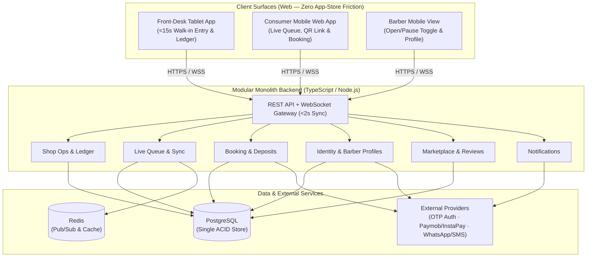

# Milestone 2: Software Architecture & Marketing Plan

## Deliverable 2.1: Architecture & Engineering Decisions

### 1. Architecture Style: Modular Monolith

**Decision:** We will build the platform as a **Modular Monolith**—a single deployable backend (TypeScript/Node.js) serving both the front-desk tablet web app and the zero-download consumer mobile web app (React/Next.js), backed by a single relational database (PostgreSQL) and an in-memory pub/sub layer (Redis) for `<2s` real-time WebSocket updates.

#### Justification by Team Size, Stage, and Expected Load
* **Team Size (1 Engineer):** Our founding team has one part-time student CTO (Abdelrahman) building the entire MVP around an academic semester. Microservices would add severe operational overhead—service discovery, distributed tracing, multi-repo CI/CD, and network debugging—that would stall delivery. A single codebase lets one engineer ship, test, and deploy rapidly.
* **Stage & Consistency Requirements (MVP Pilot → Year 1):** Our core operational risk is queue accuracy and zero double-booking (Milestone 1, Deliverable 1.3, Assumptions #4–5). Keeping all writes in one PostgreSQL database gives us strong ACID transactions (e.g., row-level locks on barber slots and queue positions) without distributed transaction complexity, while an in-process WebSocket gateway broadcasts updates to tablets and phones in `<2s`.
* **Expected Load (Pilot to Year 3 SOM):** Even during peak hours (6:00 PM – 11:00 PM, Thursdays/Fridays), expected concurrency stays well within a single modular monolith's capacity:
  * **Pilot (3 shops, ~15 chairs):** 3 front-desk tablets + ~30–60 concurrent mobile web viewers (~1–2 writes/sec).
  * **Year 1 SOM (24 shops, ~120 chairs):** 24 tablets + ~250–500 concurrent peak viewers (~5–10 writes/sec).
  * **Year 3 SOM (154 shops, ~770 chairs):** 154 tablets + ~1,500–3,000 concurrent peak viewers (~30–50 writes/sec).
* **Why *Modular* (Not an Unstructured Monolith):** The codebase enforces strict internal module boundaries (no cross-module direct table writes) aligned to our product roadmap. As the team grows or MENA expansion introduces uneven traffic spikes, individual modules—most likely `Live Queue & Sync` or `Notifications`—can be extracted into standalone services without rewriting the system.

#### High-Level Architecture

* **Service Extraction Triggers:** We will remain a Modular Monolith until we hit at least one of two thresholds: (1) engineering headcount exceeds **5+ developers** experiencing merge/deployment contention, or (2) sustained peak WebSocket concurrency exceeds **10,000+ simultaneous connections** where isolating the real-time fan-out gateway reduces compute cost.

---

### 2. Build vs. Buy & 3-Year Total Cost of Ownership (TCO)

We reserve our single CTO's engineering bandwidth for our core differentiator (the live per-barber queue, `<15s` front-desk ledger, and portable barber profiles) and evaluate three supporting capabilities on a **3-year TCO** basis.

* **Shared Baseline Assumptions:** Anchored to Milestone 1 SOM (**Year 1: 24 shops → Year 2: 68 → Year 3: 154**, totaling **~2,028 active shop-months**), **50 EGP/USD**, and a fully loaded Cairo mid-level engineering rate of **EGP 400/hr** (~EGP 64,000/month).

| Capability | Build 3-Yr TCO (EGP) | Buy 3-Yr TCO (EGP) | 3-Yr Net Savings | Lock-In Risk & Mitigation | Decision |
| :--- | :---: | :---: | :---: | :--- | :---: |
| **1. Payments & Deposits** *(Paymob vs. Direct Bank/PCI)* | **1,680,000** *(240k build + 240k maint. + 1,200k PCI/CBE)* | **336,600** *(20k integ. + 21.6k maint. + 295k fees)* | **1,343,400** *(80% cheaper)* | **Medium** (token/webhook format). Mitigated via a `PaymentProvider` adapter interface (swappable to FawryPay). | **BUY** *(Paymob)* |
| **2. Auth & Phone OTP** *(Supabase Auth vs. Custom)* | **183,750** *(72k build + 96k maint. + 15.75k SMS)* | **40,150** *(10k integ. + 14.4k maint. + 15.75k SMS)* | **143,600** *(78% cheaper)* | **Low–Medium** (open-source GoTrue on standard Postgres SQL). Mitigated via custom JWT middleware. | **BUY** *(Supabase Auth)* |
| **3. WhatsApp / SMS Alerts** *(Meta Cloud API + SMS vs. SMPP)* | **614,750** *(128k build + 144k maint. + 342.75k carrier)* | **238,000** *(16k integ. + 19.2k maint. + 202.8k msgs)* | **376,750** *(61% cheaper)* | **Low–Medium** (Meta template rules/pricing). Mitigated via a `NotificationService` router (WhatsApp → SMS → Web Push). | **BUY** *(Meta API + Local SMS)* |
| **Total (3 Capabilities)** | **2,478,500** | **614,750** | **1,863,750** | All third-party calls isolated behind module adapters. | **3/3 BUY** |

#### Number-Driven Justification
1. **Payments & Deposits (BUY — Paymob):** Across 3 years we process ~EGP 9.83M (~2,028 monthly 1,000 EGP SaaS invoices + ~195,000 advance deposits averaging 40 EGP). At a blended ~3% fee (~EGP 295k), buying Paymob saves **EGP 1.34M** and avoids 600+ engineering hours plus ~EGP 400k/year in PCI-DSS audits, pen-testing, and CBE/acquirer compliance.
2. **Authentication & Phone OTP (BUY — Supabase Auth + Local SMS):** Peak Year 3 demand (~10,000 MAU) sits comfortably inside Supabase Pro's included 100,000 MAU tier (EGP 0 incremental auth fee; only ~EGP 15.75k for ~45,000 OTP SMS at EGP 0.35 each). Buying saves **EGP 143.6k** and eliminates custom token/security maintenance for a solo engineer.
3. **WhatsApp / SMS Notifications (BUY — Meta WhatsApp Cloud API + VictoryLink SMS Fallback):** Sending ~507,000 proximity and cut-cycle alerts (~250/shop/month) costs ~EGP 202.8k at a blended EGP 0.40/message. Building a direct multi-carrier SMPP integration incurs EGP 272k in engineering/maintenance plus EGP 342.75k in carrier minimums and wholesale SMS—and still lacks WhatsApp reach.

---

### 3. Architecture Decision Records (ADRs)

#### ADR-001: Mobile-First Web App (PWA) over Cross-Platform/Native Mobile Apps for Launch
* **Context:** Customers discover the live queue by scanning a QR code at the shop counter or clicking a barber's Instagram/TikTok link, while a solo CTO must ship both the front-desk tablet and consumer interfaces in one semester.
* **Decision:** Launch as a responsive **Progressive Web App (PWA)** (Next.js/React) for both the front-desk tablet and consumer mobile views; defer native iOS/Android apps until post-Year 1.
* **Alternatives Considered:** (1) *React Native / Flutter* — single mobile codebase with native push notifications, but still requires App Store/Play Store reviews, download friction at the counter, and separate web code for tablets; (2) *Native Swift/Kotlin* — best OS integration, prohibitive effort for 1 engineer.
* **Consequences:** *Positive:* Zero-download QR access maximizes pilot conversion; one codebase and instant web deployments. *Negative:* Unreliable iOS Safari background push notifications (mitigated by WhatsApp/SMS proximity alerts) and no App Store organic search initially.

#### ADR-002: Single PostgreSQL Database over NoSQL (Firestore / MongoDB)
* **Context:** The system must guarantee zero double-booking on barber time slots, maintain accurate daily cash/service ledgers per shop, and query relational links across shops, barbers, customers, and verified reviews.
* **Decision:** Use **managed PostgreSQL** (via Supabase) as the single ACID source of truth.
* **Alternatives Considered:** (1) *Firebase Firestore* — built-in real-time client listeners accelerate initial queue UI, but lacks multi-table relational joins and strict financial ledger aggregations; (2) *MongoDB* — flexible schema, weaker fit for relational reporting and multi-tenant financial reconciliation.
* **Consequences:** *Positive:* Row-level locks (`SELECT ... FOR UPDATE`) prevent double-bookings; SQL handles daily cash tallies and owner analytics natively. *Negative:* Requires disciplined schema migrations and a separate real-time broadcast layer (ADR-003).

#### ADR-003: Self-Managed WebSockets + Redis Pub/Sub over Managed Real-Time (Pusher/Ably) or Polling
* **Context:** Queue changes logged on the front-desk tablet must appear on all viewing customer phones in `<2s` during 6–11 PM peaks while keeping per-user infrastructure costs low.
* **Decision:** Run a **WebSocket gateway inside the Modular Monolith** backed by **Redis Pub/Sub** (for horizontal fan-out when scaling past one node).
* **Alternatives Considered:** (1) *Managed Real-Time (Pusher/Ably)* — zero ops, but message/connection-based pricing spikes unpredictably during evening peak fan-out; (2) *HTTP Short Polling* — trivial to implement, but either violates `<2s` latency or wastes mobile battery/bandwidth; (3) *Server-Sent Events (SSE)* — lighter for read-only customer feeds, but unidirectional and less uniform for bidirectional tablet presence/heartbeats.
* **Consequences:** *Positive:* Sub-second bidirectional updates at flat, predictable infra cost. *Negative:* We must implement client auto-reconnect, state resync on drop, and heartbeat handling for flaky Egyptian 4G/Wi-Fi networks.

#### ADR-004: Decoupled Portable Barber Identity over Shop-Owned Staff Records
* **Context:** A core differentiator (Milestone 1) is that barbers carry their verified craftsmanship ratings and portfolio when moving between shops, while customer phone numbers and shop revenue must remain strictly private to the host shop.
* **Decision:** Model `Barber` as an independent global identity linked to a `Shop` via a time-bounded `ShopBarberAssignment` join table (`active` / `historical`), with strict row-level tenancy scoping customer PII and cash logs exclusively to `shop_id`.
* **Alternatives Considered:** (1) *Shop-Owned Staff Sub-Records* — standard SaaS pattern with simple permissions, but destroys barber portability when a barber switches shops; (2) *Barber-Owned Client Lists* — maximizes barber pull, but causes shop owners to reject the platform over client-poaching fears.
* **Consequences:** *Positive:* Protects our core marketplace moat while giving shop owners full confidence in data privacy. *Negative:* Adds authorization complexity (every query must enforce `shop_id` vs. `barber_id` boundaries) and requires clean offboarding workflows when a barber switches shops.

#### ADR-005: Deterministic Service-Duration Buffers over ML Wait-Time Prediction
* **Context:** Customers need trustworthy per-barber wait estimates (`"2 ahead, ~40 min"`) from day one of the 2–3 shop pilot, before any historical service dataset exists.
* **Decision:** Compute live ETAs deterministically using **per-service fixed durations** (e.g., 30 min haircut, 20 min beard, 45 min combo) plus a configurable per-barber pace multiplier and small buffer, while logging actual `started_at` / `finished_at` timestamps on every cut.
* **Alternatives Considered:** (1) *ML Regression Model* — could capture peak-hour variance and barber-specific speed automatically, but suffers from a complete cold-start problem at pilot launch and produces opaque errors that erode user trust; (2) *Manual Receptionist ETA Entry* — flexible, but breaks the `<15s` walk-in entry target and introduces inconsistent guesswork.
* **Consequences:** *Positive:* Zero cold-start, transparent, debuggable ETAs from day one. *Negative:* Less accurate for outlier services (e.g., complex styling) until we accumulate enough timestamped cuts to auto-calibrate per-barber averages in Year 2.
