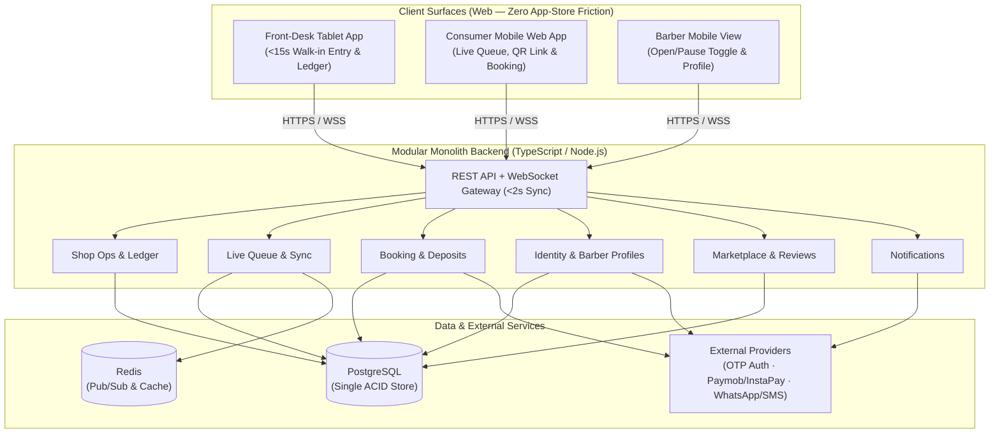

# Milestone 2: Software Architecture & Marketing Plan

## Deliverable 2.1: Architecture & Engineering Decisions

### 1. Architecture Style: Modular Monolith

**Decision:** We will build the platform as a **Modular Monolith**—a single deployable backend (TypeScript/Node.js) serving both the front-desk tablet web app and the zero-download consumer mobile web app (React/Next.js), backed by a single relational database (PostgreSQL) and an in-memory pub/sub layer (Redis) for `<2s` real-time WebSocket updates.

#### Justification by Team Size, Stage, and Expected Load
* **Team Size (1 Engineer):** Our founding team has one part-time student CTO (Abdelrahman) building the entire MVP around an academic semester. Microservices would add severe operational overhead—service discovery, distributed tracing, multi-repo CI/CD, and network debugging—that would stall delivery. A single codebase lets one engineer ship, test, and deploy rapidly.
* **Stage & Consistency Requirements (MVP Pilot → Year 1):** Our core operational risk is queue accuracy and zero double-booking (Milestone 1, Deliverable 1.3, Assumptions #4–5). Keeping all writes in one PostgreSQL database gives us strong ACID transactions (e.g., row-level locks on barber slots and queue positions) without distributed transaction complexity, while an in-process WebSocket gateway broadcasts updates to tablets and phones in `<2s`.
* **Expected Load (Pilot to Year 3 SOM):** Even during peak hours (6:00 PM – 11:00 PM, Thursdays/Fridays), expected concurrency stays well within a single modular monolith's capacity:
  * **Pilot (3 shops, ~15 chairs):** 3 front-desk tablets + ~30–60 concurrent mobile web viewers (~1–2 writes/sec).
  * **Year 1 SOM (24 shops, ~120 chairs):** 24 tablets + ~250–500 concurrent peak viewers (~5–10 writes/sec).
  * **Year 3 SOM (154 shops, ~770 chairs):** 154 tablets + ~1,500–3,000 concurrent peak viewers (~30–50 writes/sec).
* **Why *Modular* (Not an Unstructured Monolith):** The codebase enforces strict internal module boundaries (no cross-module direct table writes) aligned to our product roadmap. As the team grows or MENA expansion introduces uneven traffic spikes, individual modules—most likely `Live Queue & Sync` or `Notifications`—can be extracted into standalone services without rewriting the system.

#### High-Level Architecture

* **Service Extraction Triggers:** We will remain a Modular Monolith until we hit at least one of two thresholds: (1) engineering headcount exceeds **5+ developers** experiencing merge/deployment contention, or (2) sustained peak WebSocket concurrency exceeds **10,000+ simultaneous connections** where isolating the real-time fan-out gateway reduces compute cost.

---

### 2. Build vs. Buy & 3-Year Total Cost of Ownership (TCO)

We reserve our single CTO's engineering bandwidth for our core differentiator (the live per-barber queue, `<15s` front-desk ledger, and portable barber profiles) and evaluate three supporting capabilities on a **3-year TCO** basis.

* **Shared Baseline Assumptions:** Anchored to Milestone 1 SOM (**Year 1: 24 shops → Year 2: 68 → Year 3: 154**, totaling **~2,028 active shop-months**), **50 EGP/USD** (aligned with Milestone 1; CBE spot ~54.3 EGP/USD), and a fully loaded Cairo mid-level engineering rate of **EGP 300/hr** (~EGP 48,000/month), with **AI-assisted development** hour estimates.

| Capability | Build 3-Yr TCO (EGP) | Buy 3-Yr TCO (EGP) | 3-Yr Net Savings | Lock-In Risk & Mitigation | Decision |
| :--- | :---: | :---: | :---: | :--- | :---: |
| **1. Payments & Deposits** *(Paymob vs. Direct Bank/PCI)* | **1,395,000** *(105k build + 90k maint. + 1,200k PCI/CBE)* | **314,800** *(9k integ. + 10.8k maint. + 295k fees)* | **1,080,200** *(77% cheaper)* | **Medium** (token/webhook format). Mitigated via a `PaymentProvider` adapter interface (swappable to FawryPay). | **BUY** *(Paymob)* |
| **2. Auth & Phone OTP** *(Self-Hosted Auth Library vs. Supabase Auth)* | **33,750** *(7.2k build + 10.8k maint. + 15.75k SMS)* | **69,750** *(3.6k integ. + 5.4k maint. + 45k Pro + 15.75k SMS)* | **36,000** *(52% cheaper)* | **Low** (open-source auth library storing users in our own PostgreSQL). Mitigated by standard JWT/session middleware; zero DB-host lock-in. | **BUILD** *(Self-Hosted Auth)* |
| **3. WhatsApp / SMS Alerts** *(Meta Cloud API + SMS vs. SMPP)* | **427,950** *(42k build + 43.2k maint. + 342.75k carrier)* | **217,800** *(6k integ. + 9k maint. + 202.8k msgs)* | **210,150** *(49% cheaper)* | **Low–Medium** (Meta template rules/pricing). Mitigated via a `NotificationService` router (WhatsApp → SMS → Web Push). | **BUY** *(Meta API + Local SMS)* |
| **Total (3 Capabilities)** | **1,856,700** | **602,350** | **1,326,350** *(Chosen TCO: 566,350)* | All external providers isolated behind module adapters; auth stays DB-portable. | **2 BUY / 1 BUILD** |

#### Number-Driven Justification
1. **Payments & Deposits (BUY — Paymob):** Across 3 years we process ~EGP 9.83M (~2,028 monthly 1,000 EGP SaaS invoices + ~195,000 advance deposits averaging 40 EGP). Standard Paymob SME card checkout charges 2.75%–2.9% + EGP 3/tx (~3.05% on 1,000 EGP invoices); to avoid a ~10% effective fee on 40 EGP micro-deposits, deposits are routed via percentage-only mobile wallets/InstaPay/Meeza (or pass the EGP 3 card fixed fee via `customer_bears_fees`), keeping blended merchant fees at ~3% (~EGP 295k). Even with AI-assisted coding (350h build + 300h maint. vs. 30h integ. + 36h maint.), buying saves **EGP 1.08M** and avoids a conservative **EGP 400k/year** floor (~$8k/yr) in PCI-DSS audits, pen-testing, and CBE/acquirer compliance.
2. **Authentication & Phone OTP (BUILD — Self-Hosted Auth Library + Local SMS):** Because our PostgreSQL host is not locked to Supabase, running Supabase Auth in production with an SLA (and avoiding Free Tier's 7-day inactivity pause) requires the `$25/mo` Pro plan (`EGP 45k` over 3 years) and incurs `$0.00325/MAU` overage fees once consumer scale exceeds 100k MAU. Embedding an open-source auth library directly inside our Modular Monolith takes ~24h to set up and ~1h/mo to maintain (`EGP 18k` total labor + `EGP 15.75k` for ~45,000 OTP SMS at EGP 0.35/SMS, conservatively budgeting 70-char Arabic/Unicode 2-segment SMS and NTRA Sender ID registration), saving **EGP 36k (52% cheaper)** while keeping PostgreSQL provider-agnostic and eliminating per-MAU scaling costs.
3. **WhatsApp / SMS Notifications (BUY — Meta WhatsApp Cloud API + VictoryLink SMS Fallback):** Sending ~507,000 proximity and cut-cycle alerts (~250/shop/month) costs ~EGP 202.8k at a blended **EGP 0.40/message**—combining Meta Egypt Utility ($0.0036 ≈ EGP 0.18–0.20), local SMS fallback (~EGP 0.25), and a buffer for ~6–7% of cut-cycle reminders classified as Marketing ($0.0644 ≈ EGP 3.22–3.50). Building a direct multi-carrier SMPP integration (140h build + 144h maint. = EGP 85.2k) still incurs a conservative floor of EGP 342.75k in MNO carrier minimums and wholesale SMS—and lacks WhatsApp reach.

#### Sources
* **Exchange Rate & Regulatory:** [Central Bank of Egypt (CBE)](https://www.cbe.org.eg) · [National Telecom Regulatory Authority (NTRA)](https://www.tra.gov.eg/)
* **Cairo Engineering Rates:** [Levels.fyi — Cairo Software Engineer](https://www.levels.fyi/t/software-engineer/locations/cairo-metropolitan-area) · [EgyTech.fyi Salary Survey](https://egytech.fyi/) · [Payscale Egypt](https://www.payscale.com/research/EG/Job=Software_Engineer/Salary)
* **Payments & PCI-DSS Compliance:** [Paymob Developer Docs](https://developers.paymob.com/) · [Kashier Egypt PSP Comparison](https://kashier.io/) · [Scrut PCI-DSS Cost Guide](https://www.scrut.io/) · [Thoropass PCI Costs](https://thoropass.com/) · [Stripe PCI Guide](https://stripe.com/)
* **Auth & MAU Pricing:** [Supabase Pricing](https://supabase.com/pricing) · [Supabase Monthly Active Users Docs](https://supabase.com/docs/guides/platform/manage-your-usage/monthly-active-users)
* **WhatsApp, Local SMS & SMPP:** [Meta WhatsApp Business Platform Pricing](https://developers.facebook.com/docs/whatsapp/pricing) · [VictoryLink](https://victorylink.com/) · [SMS Misr](https://sms.com.eg/) · [Telecom Egypt WE Business](https://te.eg/) · [TekHook Egypt SMPP Overview](https://tekhook.co/)

---

### 3. Architecture Decision Records (ADRs)

#### ADR-001: Mobile-First Web App (PWA) over Cross-Platform/Native Mobile Apps for Launch
* **Context:** Customers discover the live queue by scanning a QR code at the shop counter or clicking a barber's Instagram/TikTok link, while a solo CTO must ship both the front-desk tablet and consumer interfaces in one semester.
* **Decision:** Launch as a responsive **Progressive Web App (PWA)** using a modern web framework (e.g., React/Next.js, Angular, or Vue) for both the front-desk tablet and consumer mobile views; defer native iOS/Android apps until post-Year 1.
* **Alternatives Considered:** (1) *Cross-Platform Mobile Frameworks (e.g., React Native, Flutter)* — single mobile codebase with native push notifications, but still requires App Store/Play Store reviews, download friction at the counter, and separate web code for tablets; (2) *Native Mobile Development (e.g., Swift/Kotlin)* — best OS integration, prohibitive effort for 1 engineer.
* **Consequences:** *Positive:* Zero-download QR access maximizes pilot conversion; one codebase and instant web deployments. *Negative:* Unreliable iOS Safari background push notifications (mitigated by WhatsApp/SMS proximity alerts) and no App Store organic search initially.

#### ADR-002: Single Relational (SQL) Database over NoSQL Document Stores
* **Context:** The system must guarantee zero double-booking on barber time slots, maintain accurate daily cash/service ledgers per shop, and query relational links across shops, barbers, customers, and verified reviews.
* **Decision:** Use a **managed relational (SQL) database** (e.g., PostgreSQL via Supabase or AWS RDS) as the single ACID source of truth.
* **Alternatives Considered:** (1) *Real-Time NoSQL Document Databases (e.g., Firebase Firestore)* — built-in real-time client listeners accelerate initial queue UI, but lack multi-table relational joins and strict financial ledger aggregations; (2) *Document-Oriented NoSQL Stores (e.g., MongoDB)* — flexible schema, weaker fit for relational reporting and multi-tenant financial reconciliation.
* **Consequences:** *Positive:* Row-level locks (`SELECT ... FOR UPDATE`) prevent double-bookings; SQL handles daily cash tallies and owner analytics natively. *Negative:* Requires disciplined schema migrations and a separate real-time broadcast layer (ADR-003).

#### ADR-003: Self-Managed WebSockets + In-Memory Pub/Sub over Managed Real-Time Services or Polling
* **Context:** Queue changes logged on the front-desk tablet must appear on all viewing customer phones in `<2s` during 6–11 PM peaks while keeping per-user infrastructure costs low.
* **Decision:** Run a **WebSocket gateway inside the Modular Monolith** backed by an **in-memory pub/sub broker** (e.g., Redis Pub/Sub) for horizontal fan-out when scaling past one node.
* **Alternatives Considered:** (1) *Managed Real-Time Services (e.g., Pusher, Ably)* — zero ops, but message/connection-based pricing spikes unpredictably during evening peak fan-out; (2) *HTTP Short Polling* — trivial to implement, but either violates `<2s` latency or wastes mobile battery/bandwidth; (3) *Server-Sent Events (SSE)* — lighter for read-only customer feeds, but unidirectional and less uniform for bidirectional tablet presence/heartbeats.
* **Consequences:** *Positive:* Sub-second bidirectional updates at flat, predictable infra cost. *Negative:* We must implement client auto-reconnect, state resync on drop, and heartbeat handling for flaky Egyptian 4G/Wi-Fi networks.

#### ADR-004: Decoupled Portable Barber Identity over Shop-Owned Staff Records
* **Context:** A core differentiator (Milestone 1) is that barbers carry their verified craftsmanship ratings and portfolio when moving between shops, while customer phone numbers and shop revenue must remain strictly private to the host shop.
* **Decision:** Model `Barber` as an independent global identity linked to a `Shop` via a time-bounded `ShopBarberAssignment` join table (`active` / `historical`), with strict row-level tenancy scoping customer PII and cash logs exclusively to `shop_id`.
* **Alternatives Considered:** (1) *Shop-Owned Staff Sub-Records* — standard SaaS pattern with simple permissions, but destroys barber portability when a barber switches shops; (2) *Barber-Owned Client Lists* — maximizes barber pull, but causes shop owners to reject the platform over client-poaching fears.
* **Consequences:** *Positive:* Protects our core marketplace moat while giving shop owners full confidence in data privacy. *Negative:* Adds authorization complexity (every query must enforce `shop_id` vs. `barber_id` boundaries) and requires clean offboarding workflows when a barber switches shops.

#### ADR-005: Deterministic Service-Duration Buffers over ML Wait-Time Prediction
* **Context:** Customers need trustworthy per-barber wait estimates (`"2 ahead, ~40 min"`) from day one of the 2–3 shop pilot, before any historical service dataset exists.
* **Decision:** Compute live ETAs deterministically using **per-service fixed durations** (e.g., 30 min haircut, 20 min beard, 45 min combo) plus a configurable per-barber pace multiplier and small buffer, while logging actual `started_at` / `finished_at` timestamps on every cut.
* **Alternatives Considered:** (1) *ML Regression Model* — could capture peak-hour variance and barber-specific speed automatically, but suffers from a complete cold-start problem at pilot launch and produces opaque errors that erode user trust; (2) *Manual Receptionist ETA Entry* — flexible, but breaks the `<15s` walk-in entry target and introduces inconsistent guesswork.
* **Consequences:** *Positive:* Zero cold-start, transparent, debuggable ETAs from day one. *Negative:* Less accurate for outlier services (e.g., complex styling) until we accumulate enough timestamped cuts to auto-calibrate per-barber averages in Year 2.

---

### 4. Cloud Cost Model (AWS — `eu-central-1` Frankfurt + Cairo CloudFront Edge)

We deploy on a single mainstream cloud (**AWS**), using **`eu-central-1` (Frankfurt)** (~60–80 ms RTT from Cairo, well within our `<2s` sync budget) paired with **Amazon CloudFront's Cairo Edge Location** (<20 ms local delivery for PWA assets and barber portfolios). To avoid upfront burn before product-market fit, we start on an all-in-one **Lightsail** instance at Pilot and graduate to managed **ECS Fargate + RDS + ElastiCache** only once paying shops fund the step-up.

* **Baseline Assumptions:** On-demand list prices (`730 hrs/mo`), **50 EGP/USD** (aligned with Milestone 1 & Section 2), **zero reliance on promotional credits** in unit economics. *(Note: AWS's 6-month Free Tier provides $100–$200 in credits for new accounts, covering the entire Pilot at **$0 out-of-pocket**, with AWS Activate Founders offering up to $1,000 later.)*

| Infrastructure Line Item | **100 MAU (Pilot)** *(1–3 shops · 10–30 peak WS)* | **10,000 MAU (Growth)** *(24–68 shops · 250–600 peak WS)* | **100,000 MAU (Scale — HA)** *(154–300 shops · 1.5k–3k peak WS)* |
| :--- | :---: | :---: | :---: |
| **Compute (API + WS + PWA)** | 1× Lightsail (2 vCPU, 2 GB, Docker) **$12.00** | 2× ECS Fargate ARM64 (0.5 vCPU, 2 GB) **$40.80** | 4× ECS Fargate ARM64 (1 vCPU, 2 GB) **$138.32** |
| **Load Balancer & Public IPv4** | Included in Lightsail **$0.00** | ALB ($22.63) + 4 IPv4 ($14.60) **$37.23** | ALB ($28.47) + 6 IPv4 ($21.90) **$50.37** |
| **Managed PostgreSQL (RDS)** | On Lightsail *(pilot shortcut)* **$0.00** | `db.t4g.small` 1-AZ + 30 GB gp3 **$30.83** | `db.t4g.medium` **Multi-AZ** + 100 GB gp3 **$134.12** |
| **Managed Valkey (ElastiCache)** | In-memory WS *(1 node)* **$0.00** | `cache.t4g.micro` (1 node) **$10.22** | `cache.t4g.small` **Multi-AZ** (2 nodes) **$42.34** |
| **S3 + CloudFront (Cairo Edge)** | Portfolios deferred / Free Tier **$0.00** | 20 GB S3 + 75 GB egress (1 TB Free) **$1.00** | 100 GB S3 + 400 GB egress (1 TB Free) **$7.00** |
| **Backups, DNS & Monitoring** | Snapshots ($1.00) + Route 53 ($0.50) **$1.50** | Route 53 + ~10 GB CloudWatch **$3.00** | Route 53 + ~35 GB CloudWatch **$15.50** |
| **Total Monthly Infra (USD)** | **$13.50 / mo** | **$123.08 / mo** | **$387.65 / mo** |
| **Total Monthly Infra (EGP @ 50)** | **675 EGP / mo** | **6,154 EGP / mo** | **19,383 EGP / mo** |
| **Infra Cost per Active User** | **$0.135** *(6.75 EGP)* | **$0.0123** *(0.62 EGP)* | **$0.0039** *(0.19 EGP)* |
| **Infra % of SaaS MRR** *(1k EGP/shop)* | **22.5%** *(at 3 shops; 0% w/ Free Tier)* | **9.1% – 25.6%** *(68–24 shops)* | **6.5% – 12.6%** *(300–154 shops)* |

* **Gross Margin Handoff (Milestone 3):** Pure cloud infrastructure scales from **225 EGP/shop/mo** at Pilot down to **~65–126 EGP/shop/mo** (6.5%–12.6% of the 1,000 EGP/mo SaaS fee, excluding marketplace commissions). Variable payment and messaging COGS (Paymob ~3% + WhatsApp/SMS ~100 EGP/shop/mo) are modeled separately in Section 2 and combine cleanly with this table in Milestone 3 without double-counting—leaving **~75–80%+ blended SaaS gross margin** at scale.

#### Main Cost Optimization Levers
1. **Stage-Gated Architecture (Pay Only When Established):** Running a single Lightsail node at Pilot avoids ALB ($20/mo), RDS, and ElastiCache floors until paying shops cover the $123/mo managed stack (migrating at 5–10 paying shops; tracked in Section 7).
2. **Avoid NAT Gateways & Egress Fees:** Placing ECS Fargate tasks in public subnets locked strictly to ALB Security Groups avoids a ~$38/mo NAT Gateway, while routing traffic through CloudFront keeps origin fetch at $0 and utilizes CloudFront's **1 TB/mo Always Free** egress via the Cairo Edge.
3. **ARM64 Graviton + Valkey:** Standardizing on Graviton (`ARM64` Fargate, `db.t4g.*`) and ElastiCache for **Valkey** (Redis-compatible) cuts compute and cache spend by ~20% vs. x86/Redis OSS with zero code changes.
4. **Peak-Hour Autoscaling & Savings Plans:** Scheduling Fargate scale-out strictly for Cairo peak hours (6:00–11:00 PM, Thu/Fri) and purchasing 1-Year Compute/RDS Savings Plans at 100k MAU reduces the $388/mo bill by **~25–30%** (to **~$290–$300/mo**).

#### Sources
* **Compute & Networking:** [AWS Lightsail Pricing](https://aws.amazon.com/lightsail/pricing/) · [AWS Fargate Pricing](https://aws.amazon.com/fargate/pricing/) · [Elastic Load Balancing (ALB) Pricing](https://aws.amazon.com/elasticloadbalancing/pricing/) · [VPC Public IPv4 Pricing](https://aws.amazon.com/vpc/pricing/)
* **Data, Storage & Edge:** [Amazon RDS PostgreSQL Pricing](https://aws.amazon.com/rds/postgresql/pricing/) · [Amazon ElastiCache (Valkey) Pricing](https://aws.amazon.com/elasticache/pricing/) · [Amazon S3 Pricing](https://aws.amazon.com/s3/pricing/) · [Amazon CloudFront Pricing](https://aws.amazon.com/cloudfront/pricing/)
* **DNS, Monitoring & Credits:** [Amazon Route 53 Pricing](https://aws.amazon.com/route53/pricing/) · [Amazon CloudWatch Pricing](https://aws.amazon.com/cloudwatch/pricing/) · [AWS Free Tier](https://aws.amazon.com/free/) · [AWS Activate](https://aws.amazon.com/startups/credits)

---

### 5. Regulation and Compliance

*(Placeholder — to be completed)*

---

### 6. Vendors and Platform Risk

*(Placeholder — to be completed)*

---

### 7. Technical Debt Policy

As a solo-CTO startup shipping an MVP around an academic semester, we take **deliberate, time-boxed shortcuts** to validate shop-floor adoption quickly while tying every shortcut to a concrete business trigger for repayment:

| Deliberate MVP Shortcut | Why We Take It Now | Repayment Trigger | Repayment Plan |
| :--- | :--- | :--- | :--- |
| **1. All-in-One Lightsail Node** *(self-hosted Postgres + in-memory WS)* | Saves ~$110/mo ($0 w/ Free Tier) and avoids VPC/ALB setup during the 3-shop pilot. | **5–10 paying shops** (~5k–10k EGP MRR) or multi-node scale need. | Migrate to managed ECS Fargate + RDS PostgreSQL + ElastiCache Valkey (Section 4). |
| **2. Manual Concierge Deposits** *(InstaPay/wallet verification)* | Tests deposit willingness (M1 Assumption #2) immediately without waiting weeks for Paymob/CBE merchant onboarding. | **Q2 (≥6 active shops)** or **>50 deposits/week**. | Connect `PaymentProvider` adapter to Paymob API + automated webhooks (Section 2). |
| **3. Hardcoded Service-Duration ETAs** *(30m hair / 20m beard)* | Eliminates cold-start errors on Day 1 while still logging actual `started_at`/`finished_at` timestamps (ADR-005). | **1,000+ logged cuts/shop** (Q3–Q4). | Replace static defaults with rolling per-barber median durations. |
| **4. Critical-Path-Only Testing** *(no E2E suite or staging env)* | Keeps MVP velocity high while still testing zero-tolerance invariants (slot locking & daily cash ledger math). | **10 active shops** or hiring **Engineer #2**. | Add automated CI/CD staging environment and Playwright E2E tests for core flows. |
| **5. Manual Shop Onboarding** *(no self-serve B2B portal)* | White-glove setup takes ~15 min/shop at 2 shops/month and saves weeks of admin CRUD UI work. | **Year 2** (hiring Sales Rep #1 at **≥4 shops/month**). | Build self-serve shop, barber, and service-menu onboarding wizard. |

* **Repayment Rule:** Post-pilot, we allocate **20% of engineering capacity** (1 day/week) to retire triggered debt before starting new roadmap features; no shortcut remains open past its trigger without explicit CEO/CTO sign-off.
