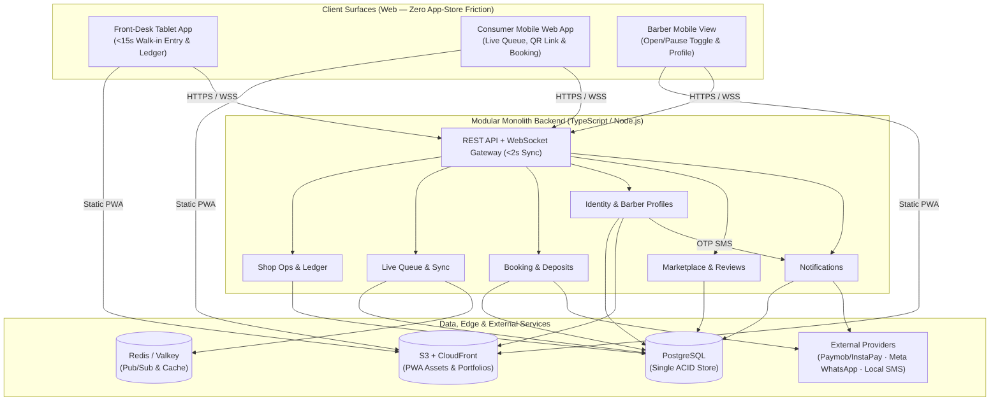

# Milestone 2: Software Architecture & Marketing Plan

## Deliverable 2.1: Architecture & Engineering Decisions

### 1. Architecture Style: Modular Monolith

**Decision:** We will build the platform as a **Modular Monolith**—a single deployable backend (TypeScript/Node.js) serving our responsive PWA views (front-desk tablet, zero-download consumer mobile web, and barber mobile view), backed by a single relational database (PostgreSQL) and an in-memory pub/sub layer (Redis/Valkey once scaling past one node) for `<2s` real-time WebSocket updates.

#### Justification by Team Size, Stage, and Expected Load
* **Team Size (1 Engineer):** Our founding team has one part-time student CTO (Abdelrahman) building the entire MVP around an academic semester. Microservices would add severe operational overhead—service discovery, distributed tracing, multi-repo CI/CD, and network debugging—that would stall delivery. A single codebase lets one engineer ship, test, and deploy rapidly.
* **Stage & Consistency Requirements (MVP Pilot → Year 1):** Our core operational risk is queue accuracy and zero double-booking (Milestone 1, Deliverable 1.3, Assumptions #4–5). Keeping all writes in one PostgreSQL database gives us strong ACID transactions (e.g., row-level locks on barber slots and queue positions) without distributed transaction complexity, while an in-process WebSocket gateway broadcasts updates to tablets and phones in `<2s`.
* **Expected Load (Pilot to Year 3 SOM):** Even during peak hours (6:00 PM – 11:00 PM, Thursdays/Fridays), expected concurrency stays well within a single modular monolith's capacity:
  * **Pilot (1–3 shops, ~15 chairs; 100 MAU initial ramp):** 3 front-desk tablets + ~10–15 concurrent peak mobile viewers (~15–20 peak WS, <1–2 writes/sec).
  * **Year 1 SOM (24 shops, ~120 chairs; ~10k MAU):** 24 tablets + ~250–500 concurrent peak viewers (~275–525 peak WS, ~5–10 writes/sec; scaling to ~750–1,400 peak WS at Year 2's 68 shops).
  * **Year 3 SOM (154 shops, ~770 chairs):** 154 tablets + ~1,500–3,000 concurrent peak viewers (~1,650–3,150 peak WS, ~30–50 writes/sec; scaling to ~3.3k–6k peak WS at 300 shops / 100k MAU).
* **Why *Modular* (Not an Unstructured Monolith):** The codebase enforces strict internal module boundaries (no cross-module direct table writes) aligned to our product roadmap. As the team grows or MENA expansion introduces uneven traffic spikes, individual modules—most likely `Live Queue & Sync` or `Notifications`—can be extracted into standalone services without rewriting the system.

#### High-Level Architecture

* **Service Extraction Triggers:** We will remain a Modular Monolith until we hit at least one of two thresholds: (1) engineering headcount exceeds **5+ developers** experiencing merge/deployment contention, or (2) sustained peak WebSocket concurrency exceeds **10,000+ simultaneous connections** where isolating the real-time fan-out gateway reduces compute cost.

---

### 2. Build vs. Buy & 3-Year Total Cost of Ownership (TCO)

We reserve our single CTO's engineering bandwidth for our core differentiator (the live per-barber queue, `<15s` front-desk ledger, and portable barber profiles) and evaluate three supporting capabilities on a **3-year TCO** basis.

* **Shared Baseline Assumptions:** Anchored to Milestone 1 SOM (**Year 1: 24 shops → Year 2: 68 → Year 3: 154**, totaling **~2,028 active shop-months** and **~1,860 billed SaaS invoices** after Milestone 1's 1-month free trial on 168 newly signed shops), **50 EGP/USD** (aligned with Milestone 1; CBE spot ~54.3 EGP/USD), and a Cairo mid-level engineering market replacement rate of **EGP 300/hr** (~EGP 48,000/month), with **AI-assisted development** hour estimates.

| Capability | Build 3-Yr TCO (EGP) | Buy 3-Yr TCO (EGP) | 3-Yr Net Savings | Lock-In Risk & Mitigation | Decision |
| :--- | :---: | :---: | :---: | :--- | :---: |
| **1. Payments & Deposits** *(Paymob vs. Direct Bank/PCI)* | **1,428,480** *(105k build + 90k maint. + 1,200k PCI/CBE + 33.5k bank MDR)* | **76,530** *(9k integ. + 10.8k maint. + 56.7k SaaS fees; deposit fees netted from shop settlements)* | **1,351,950** *(95% cheaper)* | **Medium** (token/webhook format). Mitigated via a `PaymentProvider` adapter interface (swappable to FawryPay). | **BUY** *(Paymob)* |
| **2. Auth & Phone OTP** *(Self-Hosted Auth Library vs. Supabase Auth)* | **50,700** *(12k build + 16.2k maint. + 22.5k SMS)* | **79,500** *(4.8k integ. + 7.2k maint. + 45k Pro + 22.5k SMS)* | **28,800** *(36% cheaper)* | **Low** (open-source auth library storing users in our own PostgreSQL). Mitigated by standard JWT/session middleware; zero DB-host lock-in. | **BUILD** *(Self-Hosted Auth)* |
| **3. WhatsApp / SMS Alerts** *(Meta Cloud API + SMS vs. SMPP)* | **427,950** *(42k build + 43.2k maint. + 342.75k carrier)* | **217,800** *(6k integ. + 9k maint. + 202.8k msgs)* | **210,150** *(49% cheaper)* | **Low–Medium** (Meta template rules/pricing). Mitigated via a `NotificationService` router (Web Push [opt-in] → WhatsApp → SMS). | **BUY** *(Meta API + Local SMS)* |
| **Total (3 Capabilities)** | **1,907,130** | **373,830** | **1,562,100 vs. All-Build** *(28,800 vs. All-Buy · 1,590,900 vs. rejected options; Chosen TCO: 345,030)* | All external providers isolated behind module adapters; auth stays DB-portable. | **2 BUY / 1 BUILD** |

#### Number-Driven Justification
1. **Payments & Deposits (BUY — Paymob):** Across 3 years Paymob processes **~EGP 9.66M** (~1,860 billed 1,000 EGP SaaS invoices after the 1-month free trial on 168 newly signed shops, plus ~195,000 post-Q1 pass-through advance deposits averaging 40 EGP, or ~EGP 7.80M, following Q1's manual concierge InstaPay pilot in Section 7). Standard Paymob SME card checkout charges 2.75% + EGP 3/tx (**30.50 EGP / 3.05%** on 1,000 EGP SaaS invoices), resulting in **EGP 56,730** in platform-borne SaaS billing fees over 3 years. For the ~195,000 customer deposits, payments are routed via percentage-only mobile wallets/InstaPay/Meeza (~3%, or ~1.20 EGP/deposit, avoiding the EGP 3 fixed card fee) and **deducted directly from each shop's deposit settlement** via Paymob Marketplace sub-merchant split settlements (~EGP 234k pass-through merchant cost, EGP 0 net platform COGS, and zero surcharge to customers—preserving Milestone 1's "free for customers" promise). Even with AI-assisted coding (350h build + 300h maint. vs. 30h integ. + 36h maint.) and an apples-to-apples direct-acquirer bank MDR floor of ~1.8% on SaaS billing (**EGP 33,480**, with deposit MDR similarly netted from shops), buying saves **EGP 1.35M (95% cheaper)** and avoids a conservative **EGP 400k/year** floor (~$8k/yr) in PCI-DSS audits, pen-testing, and CBE/acquirer compliance.
2. **Authentication & Phone OTP (BUILD — Self-Hosted Auth Library + Local SMS):** Live-queue QR/social viewers browse anonymously with **zero login and zero OTP** (counting toward Cloud Total MAU in Section 4, not Auth MAU). Only customers taking account-bound actions (remote queue alerts, deposit bookings, barber follows, verified reviews) authenticate via Phone OTP with **90-day sliding refresh tokens**—yielding ~50,000 unique authenticated customers across 168 onboarded shops (+ ~900 staff/barbers) and **~90,000 OTP SMS** over 3 years (~1.8 OTPs/user). Because a short 6-digit OTP fits in a single SMS segment (**EGP 0.25/SMS**, including amortized NTRA Sender ID registration), OTP SMS costs **EGP 22.5k** in both options. Because our PostgreSQL database lives on AWS RDS (not Supabase), running Supabase Auth standalone with an SLA (avoiding Free Tier's 7-day inactivity pause) requires the `$25/mo` Pro plan (`EGP 45k` over 3 years) plus ~16h integration and ~24h maintenance (`EGP 12k`) to bridge external auth UIDs into our RDS RBAC and custom Egyptian SMS hooks (`$0` MAU overage within 3-year SOM since authenticated MAU stays at ~25k–45k). Embedding an open-source auth library inside our Modular Monolith takes **~40h build + ~1.5h/mo maintenance** (`EGP 28.2k` labor, explicitly budgeting OTP SMS-pumping/rate-limit fraud protection and ADR-004's multi-tenant `shop_id`/`barber_id` RBAC), saving **EGP 28.8k (36% cheaper)** immediately while keeping PostgreSQL provider-agnostic and protecting post-Year 3 MENA expansion from `$0.00325/MAU` overages past 100k authenticated MAU.
3. **WhatsApp / SMS Notifications (BUY — Meta WhatsApp Cloud API + VictoryLink SMS Fallback):** Sending ~507,000 proximity, booking, and cut-cycle alerts (~250/shop/month) costs ~EGP 202.8k at a blended **EGP 0.40/message**—combining ~82% Meta Egypt Utility (`$0.0036` = EGP 0.18 at 50 EGP/USD), ~12% longer 2-segment Arabic SMS fallback (`~EGP 0.35/SMS`), and ~6% of total alerts (the proactive cut-cycle reminders, which Meta classifies as Marketing at `$0.0644` = EGP 3.22). Building a direct multi-carrier SMPP integration (140h build + 144h maint. = EGP 85.2k) still incurs a conservative floor of EGP 342.75k in MNO carrier minimums and wholesale SMS—and lacks WhatsApp reach.

#### Sources
* **Exchange Rate & Regulatory:** [Central Bank of Egypt (CBE)](https://www.cbe.org.eg) · [National Telecom Regulatory Authority (NTRA)](https://www.tra.gov.eg/)
* **Cairo Engineering Rates:** [Levels.fyi — Cairo Software Engineer](https://www.levels.fyi/t/software-engineer/locations/cairo-metropolitan-area) · [EgyTech.fyi Salary Survey](https://egytech.fyi/) · [Payscale Egypt](https://www.payscale.com/research/EG/Job=Software_Engineer/Salary)
* **Payments & PCI-DSS Compliance:** [Paymob Developer Docs](https://developers.paymob.com/) · [Kashier Egypt PSP Comparison](https://kashier.io/) · [Scrut PCI-DSS Cost Guide](https://www.scrut.io/) · [Thoropass PCI Costs](https://thoropass.com/) · [Stripe PCI Guide](https://stripe.com/)
* **Auth & MAU Pricing:** [Supabase Pricing](https://supabase.com/pricing) · [Supabase Monthly Active Users Docs](https://supabase.com/docs/guides/platform/manage-your-usage/monthly-active-users)
* **WhatsApp, Local SMS & SMPP:** [Meta WhatsApp Business Platform Pricing](https://developers.facebook.com/docs/whatsapp/pricing) · [VictoryLink](https://victorylink.com/) · [SMS Misr](https://sms.com.eg/) · [Telecom Egypt WE Business](https://te.eg/) · [TekHook Egypt SMPP Overview](https://tekhook.co/)

---

### 3. Architecture Decision Records (ADRs)

#### ADR-001: Mobile-First Web App (PWA) over Cross-Platform/Native Mobile Apps for Launch
* **Context:** Customers discover the live queue by scanning a QR code at the shop counter or clicking a barber's Instagram/TikTok link, while a solo CTO must ship the front-desk tablet, consumer mobile, and barber mobile interfaces in one semester.
* **Decision:** Launch as a responsive **Progressive Web App (PWA)** using a modern web framework (e.g., React/Next.js, Angular, or Vue) for all three client views, serving static PWA assets via S3 + CloudFront so frontend deploys never drop stateful backend WebSocket connections; defer native iOS/Android apps until post-Year 1.
* **Alternatives Considered:** (1) *Cross-Platform Mobile Frameworks (e.g., React Native, Flutter)* — single mobile codebase with native push notifications, but still requires App Store/Play Store reviews, download friction at the counter, and separate web code for tablets; (2) *Native Mobile Development (e.g., Swift/Kotlin)* — best OS integration, prohibitive effort for 1 engineer.
* **Consequences:** *Positive:* Zero-download QR access maximizes pilot conversion; one codebase and instant web deployments decoupled from WebSocket uptime. *Negative:* Unreliable iOS Safari background push notifications (mitigated by WhatsApp/SMS proximity alerts) and no App Store organic search initially.

#### ADR-002: Single Relational (SQL) Database over NoSQL Document Stores
* **Context:** The system must guarantee zero double-booking on barber time slots, maintain accurate daily cash/service ledgers per shop, and query relational links across shops, barbers, customers, and verified reviews.
* **Decision:** Use **PostgreSQL** as the single ACID source of truth—self-hosted on Lightsail during the 3-shop pilot, then migrated to managed **AWS RDS** at Stage 1 (4–5 paying shops) for automated point-in-time recovery (PITR) backups.
* **Alternatives Considered:** (1) *Real-Time NoSQL Document Databases (e.g., Firebase Firestore)* — built-in real-time client listeners accelerate initial queue UI, but lack multi-table relational joins and strict financial ledger aggregations; (2) *Document-Oriented NoSQL Stores (e.g., MongoDB)* — flexible schema, weaker fit for relational reporting and multi-tenant financial reconciliation.
* **Consequences:** *Positive:* Row-level locks (`SELECT ... FOR UPDATE`) prevent double-bookings; SQL handles daily cash tallies and owner analytics natively without BaaS vendor lock-in. *Negative:* Requires disciplined schema migrations and a separate real-time broadcast layer (ADR-003).

#### ADR-003: Self-Managed WebSockets + In-Memory Pub/Sub over Managed Real-Time Services or Polling
* **Context:** Queue changes logged on the front-desk tablet must appear on all viewing customer phones in `<2s` during 6–11 PM peaks while keeping per-user infrastructure costs low.
* **Decision:** Run a **WebSocket gateway inside the Modular Monolith** backed by an **in-memory pub/sub broker** (Redis/Valkey Pub/Sub via ElastiCache) for horizontal fan-out once scaling past one node.
* **Alternatives Considered:** (1) *Managed Real-Time Services (e.g., Pusher, Ably)* — zero ops, but message/connection-based pricing spikes unpredictably during evening peak fan-out; (2) *HTTP Short Polling* — trivial to implement, but either violates `<2s` latency or wastes mobile battery/bandwidth; (3) *Server-Sent Events (SSE)* — lighter for read-only customer feeds, but unidirectional and less uniform for bidirectional tablet presence/heartbeats.
* **Consequences:** *Positive:* Sub-second bidirectional updates at flat, predictable infra cost. *Negative:* We must implement client auto-reconnect, state resync on drop, and heartbeat handling for flaky Egyptian 4G/Wi-Fi networks.

#### ADR-004: Decoupled Portable Barber Identity over Shop-Owned Staff Records
* **Context:** A core differentiator (Milestone 1) is that barbers carry their verified craftsmanship ratings and portfolio when moving between shops, while customer phone numbers and shop revenue must remain strictly private to the host shop.
* **Decision:** Model `Barber` as an independent global identity linked to a `Shop` via a time-bounded `ShopBarberAssignment` join table (`active` / `historical`), with strict row-level tenancy scoping customer PII and cash logs exclusively to `shop_id`. Customers who voluntarily follow a barber's public profile can still locate his new shop on the marketplace, while raw client phone numbers and visit history remain locked to the prior `shop_id`.
* **Alternatives Considered:** (1) *Shop-Owned Staff Sub-Records* — standard SaaS pattern with simple permissions, but destroys barber portability when a barber switches shops; (2) *Barber-Owned Client Lists* — maximizes barber pull, but causes shop owners to reject the platform over client-poaching fears.
* **Consequences:** *Positive:* Protects our core marketplace moat while giving shop owners full confidence in data privacy. *Negative:* Adds authorization complexity (every query must enforce `shop_id` vs. `barber_id` boundaries) and requires clean offboarding workflows when a barber switches shops.

#### ADR-005: Deterministic Service-Duration Buffers over ML Wait-Time Prediction
* **Context:** Customers need trustworthy per-barber wait estimates (`"2 ahead, ~40 min"`) from day one of the 2–3 shop pilot, before any historical service dataset exists.
* **Decision:** Compute live ETAs deterministically using **per-service fixed durations** (e.g., 30 min haircut, 20 min beard, 45 min combo) plus a small buffer on Day 1, while logging actual `started_at` / `finished_at` timestamps on every cut to transition to rolling per-barber medians once enough history exists.
* **Alternatives Considered:** (1) *ML Regression Model* — could capture peak-hour variance and barber-specific speed automatically, but suffers from a complete cold-start problem at pilot launch and produces opaque errors that erode user trust; (2) *Manual Receptionist ETA Entry* — flexible, but breaks the `<15s` walk-in entry target and introduces inconsistent guesswork.
* **Consequences:** *Positive:* Zero cold-start, transparent, debuggable ETAs from day one. *Negative:* Less accurate for outlier services (e.g., complex styling) until each barber accumulates **~1,000+ logged cuts (~Q3–Q4 / 3–4 months of active history)** to calibrate rolling per-barber medians (Section 7).

---

### 4. Cloud Cost Model (AWS — `eu-central-1` Frankfurt + Cairo CloudFront Edge)

We deploy on a single mainstream cloud (**AWS**), using **`eu-central-1` (Frankfurt)** (~60–80 ms RTT from Cairo, well within our `<2s` sync budget) paired with **Amazon CloudFront's Cairo Edge Location** (<20 ms local delivery for PWA assets and barber portfolios). To avoid upfront burn before product-market fit, we start on an all-in-one **Lightsail** instance at Pilot, offload only **PostgreSQL to managed RDS** during early commercial rollout (4–14 shops), and graduate to the full managed **ECS Fargate + ALB + RDS + ElastiCache** stack only once 15–20+ paying shops comfortably fund the step-up.

* **Baseline Assumptions:** On-demand list prices (`730 hrs/mo`), **50 EGP/USD** (aligned with Milestone 1 & Section 2), **zero reliance on promotional credits** in unit economics. *(Note: AWS's 6-month Free Tier provides $100–$200 in credits for new accounts, covering the entire Pilot at **$0 out-of-pocket**, with AWS Activate Founders offering up to $1,000 later.)*

| Infrastructure Line Item | **100 MAU (Pilot)** *(1–3 shops · ~15–20 peak WS)* | **10,000 MAU (Growth)** *(24–68 shops · 275–1,400 peak WS)* | **100,000 MAU (Scale — HA)** *(154–300 shops · 1.7k–6k peak WS)* |
| :--- | :---: | :---: | :---: |
| **Compute (API + WS + PWA)** | 1× Lightsail (2 vCPU, 2 GB, Docker) **$12.00** | 2× ECS Fargate ARM64 (0.5 vCPU, 2 GB) **$40.80** | 4× ECS Fargate ARM64 (1 vCPU, 2 GB) **$138.32** |
| **Load Balancer & Public IPv4** | Included in Lightsail **$0.00** | ALB ($22.63) + 4 IPv4 ($14.60) **$37.23** | ALB ($28.47) + 6 IPv4 ($21.90) **$50.37** |
| **Managed PostgreSQL (RDS)** | On Lightsail *(pilot shortcut)* **$0.00** | `db.t4g.small` 1-AZ + 30 GB gp3 **$30.83** | `db.t4g.medium` **Multi-AZ** + 100 GB gp3 **$134.12** |
| **Managed Valkey (ElastiCache)** | In-memory WS *(1 node)* **$0.00** | `cache.t4g.micro` (1 node) **$10.22** | `cache.t4g.small` **Multi-AZ** (2 nodes) **$42.34** |
| **S3 + CloudFront (Cairo Edge)** | Portfolios deferred / Free Tier **$0.00** | 20 GB S3 + 75 GB egress (1 TB Free) **$1.00** | 100 GB S3 + 400 GB egress (1 TB Free) **$7.00** |
| **Backups, DNS & Monitoring** | Snapshots ($1.00) + Route 53 ($0.50) **$1.50** | Route 53 + ~10 GB CloudWatch **$3.00** | Route 53 + ~35 GB CloudWatch **$15.50** |
| **Total Monthly Infra (USD)** | **$13.50 / mo** | **$123.08 / mo** | **$387.65 / mo** |
| **Total Monthly Infra (EGP @ 50)** | **675 EGP / mo** | **6,154 EGP / mo** | **19,383 EGP / mo** |
| **Infra Cost per Active User** | **$0.135** *(6.75 EGP)* | **$0.0123** *(0.62 EGP)* | **$0.0039** *(0.19 EGP)* |
| **Infra % of SaaS MRR** *(1k EGP/shop)* | **22.5%** *(at 3 shops; 0% w/ Free Tier)* | **9.1% – 25.6%** *(68–24 shops)* | **6.5% – 12.6%** *(300–154 shops)* |

* **Gross Margin Handoff (Milestone 3):** Pure cloud infrastructure stays at **225 EGP/shop/mo** at Pilot, temporarily steps up to **~256 EGP/shop/mo** (25.6% of MRR) upon migrating to the managed Growth stack at ~20–24 shops, and then scales down to **~91 EGP/shop/mo** at 68 shops and **~65–126 EGP/shop/mo** (6.5%–12.6% of the 1,000 EGP/mo SaaS fee at 300–154 shops, excluding marketplace commissions). Combining this with platform-borne variable COGS from Section 2—**Paymob SaaS billing (~30.5 EGP/shop/mo; deposit processing fees are deducted from shop deposit settlements)**, **WhatsApp/SMS alerts (~100 EGP/shop/mo)**, and **OTP SMS (~11 EGP/shop/mo)**—yields **~206–267 EGP/shop/mo** in total COGS and a **~73–79% blended SaaS gross margin** at scale without double-counting.

#### Main Cost Optimization Levers
1. **Two-Step Stage-Gated Architecture (Never Run Infra Underwater):** Running a single Lightsail node at Pilot (`$13.50/mo`) easily handles up to ~15–20 shops (~170–420 peak WS, <20% CPU) without ALB/ElastiCache fixed floors. At **4–14 paying shops** (`4k–14k EGP MRR`), we move **only PostgreSQL** to managed RDS (`~$30–$55/mo` total = ~20%–38% of MRR) for automated PITR ledger backups, and only graduate to the full `$123/mo` (`6,154 EGP/mo`) multi-node ECS Fargate + ALB + Valkey stack at **15–20 paying shops** (`15k–20k EGP MRR`, tracked in Section 7).
2. **Avoid NAT Gateways & Egress Fees:** Placing ECS Fargate tasks in public subnets locked strictly to ALB Security Groups avoids a ~$38/mo NAT Gateway, while routing traffic through CloudFront keeps origin fetch at $0 and utilizes CloudFront's **1 TB/mo Always Free** egress via the Cairo Edge.
3. **ARM64 Graviton + Valkey:** Standardizing on Graviton (`ARM64` Fargate, `db.t4g.*`) and ElastiCache for **Valkey** (Redis-compatible) cuts compute and cache spend by ~20% vs. x86/Redis OSS with zero code changes.
4. **Peak-Hour Autoscaling & Savings Plans:** Scheduling Fargate scale-out strictly for Cairo peak hours (6:00–11:00 PM, Thu/Fri) and purchasing 1-Year Compute/RDS Savings Plans at 100k MAU reduces the $388/mo bill by **~25–30%** (to **~$290–$300/mo**).

#### Sources
* **Compute & Networking:** [AWS Lightsail Pricing](https://aws.amazon.com/lightsail/pricing/) · [AWS Fargate Pricing](https://aws.amazon.com/fargate/pricing/) · [Elastic Load Balancing (ALB) Pricing](https://aws.amazon.com/elasticloadbalancing/pricing/) · [VPC Public IPv4 Pricing](https://aws.amazon.com/vpc/pricing/)
* **Data, Storage & Edge:** [Amazon RDS PostgreSQL Pricing](https://aws.amazon.com/rds/postgresql/pricing/) · [Amazon ElastiCache (Valkey) Pricing](https://aws.amazon.com/elasticache/pricing/) · [Amazon S3 Pricing](https://aws.amazon.com/s3/pricing/) · [Amazon CloudFront Pricing](https://aws.amazon.com/cloudfront/pricing/)
* **DNS, Monitoring & Credits:** [Amazon Route 53 Pricing](https://aws.amazon.com/route53/pricing/) · [Amazon CloudWatch Pricing](https://aws.amazon.com/cloudwatch/pricing/) · [AWS Free Tier](https://aws.amazon.com/free/) · [AWS Activate](https://aws.amazon.com/startups/credits)

---

### 5. Regulation and Compliance

*(Placeholder — to be completed)*

---

### 6. Vendors and Platform Risk

## Critical Service: Payment Gateway

We chose the payment gateway because both of our revenue flows depend on it:
- the EGP 1,000 monthly shop subscription, and
- the EGP 30–50 customer booking deposits (Milestone 1 roadmap, Months 4–6).

If it fails, we cannot collect revenue and booked slots are not secured.

**Requirements specific to Egypt:**
- **Wallets, not just cards.** Only 22% of Egyptian adults owned a debit or credit card in 2021 [11].
- **InstaPay support.** InstaPay had about 16 million users by mid-2025 [12].
- **A current Central Bank licence.** Every payment provider must hold a licence under the June 2025 rules, whose grace period ended on 31 May 2026 [13].

## Mini-RFP: Vendor Scoring

Each vendor is scored from 1 (weak) to 5 (strong). The weighted score = Σ(score × weight).

| Criterion | Weight | Paymob | Kashier | Fawry (FawryPay) |
|---|---|---|---|---|
| **Payment methods** (cards, wallets, InstaPay) | 25% | **5:** cards and all major wallets (Vodafone Cash, Orange Cash, e& money, WE Pay) [3]; InstaPay announced [5] | **3:** card payments; its FAQ lists wallets as "coming soon" [6] | **4:** cards plus cash at 166,500+ locations [9] |
| **Recurring billing** for subscriptions | 20% | **5:** built-in subscription module with automatic monthly charges [4] | **4:** supports recurring payments [7] | **2:** no public subscription feature |
| **Cost** | 20% | **4:** 2.75% + EGP 3, no setup or monthly fee [1] | **4:** 2.75–2.85% + EGP 3, no monthly fee, no charge on failed transactions [2][6] | **2:** rates not published, quote only [2] |
| **Settlement speed** (cash flow) | 10% | **3:** weekly [2] | **5:** same-day, T+1 or T+2 [2] | **2:** not published |
| **Compliance and security** | 15% | **5:** first fintech licensed by the Central Bank of Egypt as a Payments Facilitator (2018) [14]; PCI-compliant with 3-D Secure [5] | **5:** Central Bank-approved payment provider since 2019 [7] | **5:** fully regulated [10] |
| **Integration and support** | 10% | **5:** full API docs, mobile SDKs, sandbox [3] | **3:** API and sandbox, but weak merchant support reviews [8] | **3:** API available, merchant onboarding required |
| **Weighted score** | 100% | **4.60** | **3.90** | **3.05** |

**Decision:**
- **Primary: Paymob.** It is the only candidate with both wallets and a ready subscription module, which match our two revenue flows.
- **Backup: Kashier.** It settles fastest and is also Central Bank-approved, so it is the fallback gateway (see risk register).
- **Fawry:** revisit later only if many customers want to pay deposits in cash.

## SLA and IP Terms We Would Insist On

| Type | Term | Why |
|---|---|---|
| **SLA: uptime** | **≥ 99.9% monthly uptime, with notice of any outage.** Paymob's standard merchant terms include no uptime commitment [15], so we negotiate this once our volume qualifies for a custom agreement. Until then, we monitor the gateway ourselves and keep Kashier ready as a backup | If payments fail, shops can't pay us |
| **SLA: settlement** | A settlement schedule fixed in our merchant application (Paymob settles at the frequency chosen there [15]). Any withheld funds explained in writing with a reason | Protects our cash flow |
| **IP: our data** | We own our software and all shop, customer and transaction data. The vendor may use it only to process our payments, in line with Egypt's Personal Data Protection Law No. 151 of 2020 | Our shop and customer data is our main asset |
| **IP: licences and data on exit** | Paymob licenses its software and SDK to us on a non-exclusive basis (as in its standard terms [15]) and gains no rights in our software. On exit, we receive a full export of our transaction data | Our product stays fully ours, and we can move to another gateway without losing our records |

## Platform Dependency Risk Register

Probability (P) and impact (I) are rated 1–5. Score = P × I.

| # | Dependency | Risk | P | I | Score | Mitigation |
|---|---|---|---|---|---|---|
| 1 | **Shop's own device** | The front-desk device is dead or lost, so the queue stops updating | 3 | 4 | **12** | The system works in any browser, so staff log in on another phone in seconds. Paper fallback for short outages, entered later |
| 2 | **Payment gateway** (single provider) | Outage or account freeze stops collections | 2 | 5 | **10** | Kashier ready as a backup gateway. InstaPay manual transfer (our MVP method) as a last resort |
| 3 | **Cloud hosting** (single provider) | Outage takes the live queue offline at every shop | 2 | 5 | **10** | Hosting across multiple data centres, daily backups, and an alert when the queue stops syncing |

There is no AI API dependency in the MVP: wait times use fixed service times (30 minutes for hair, 20 for a beard), so there is no single-AI-provider risk.

## References

[1] Paymob, "Pricing" (standard 2.75% + EGP 3). https://paymob.com/en/pricing 
[2] Startupik, "Payment Gateways for Startups in Egypt," Nov 2026. https://startupik.com/payment-gateways-for-startups-in-egypt/ 
[3] Paymob Developers, documentation overview (supported wallets, SDKs). https://developers.paymob.com/paymob-docs/llms.txt 
[4] Paymob Developers, "Subscriptions." https://developers.paymob.com/paymob-docs/payments-and-features/core-features/subscriptions 
[5] WooCommerce, "Paymob" (payment methods, PCI compliance, InstaPay). https://woocommerce.com/products/paymob/ 
[6] Kashier, "FAQs." https://kashier.io/en/faqs 
[7] KrASIA, "Egyptian payments platform Kashier raises six-figure seed." https://kr-asia.com/egyptian-payments-platform-kashier-raises-six-figure-seed 
[8] Shopify App Store, "Kashier Online Payments" (merchant reviews). https://apps.shopify.com/kashier-online-payments 
[9] Checkout.com, "Fawry." https://www.checkout.com/payment-methods/fawry 
[10] Tap Payments, "Fawry." https://www.tap.company/products/payment-methods/fawry 
[11] PYMNTS, "Egypt news and trends" (World Bank 2021 card ownership). https://www.pymnts.com/trends/egypt 
[12] Chambers and Partners, "Fintech 2026: Egypt, Trends and Developments." https://practiceguides.chambers.com/practice-guides/fintech-2026/egypt/trends-and-developments 
[13] Chambers and Partners, "Fintech 2026" guide, p. 237 (PSP licensing grace period). https://gpg-pdf.chambers.com/fintech-2026/238/ 
[14] Zawya, "Paymob enables Apple Pay acceptance for its merchants in Egypt" (CBE Payments Facilitator licence, 2018). https://www.zawya.com/en/press-release/companies-news/paymob-enables-apple-pay-acceptance-for-its-merchants-in-egypt-ycbdpsjc 
[15] Paymob, "General and Special Terms and Conditions" (merchant terms, Oman edition; the Egypt edition is issued at sign-up). https://om.paymob.com/terms-conditions

---

### 7. Technical Debt Policy

As a solo-CTO startup shipping an MVP around an academic semester, we take **deliberate, time-boxed shortcuts** to validate shop-floor adoption quickly while tying every shortcut to a concrete business trigger for repayment:

| Deliberate MVP Shortcut | Why We Take It Now | Repayment Trigger | Repayment Plan |
| :--- | :--- | :--- | :--- |
| **1. All-in-One Lightsail Node** *(self-hosted Postgres + in-memory WS)* | Saves ~$110/mo ($0 w/ Free Tier) and avoids VPC/ALB setup during the 3-shop pilot; 1 Node.js instance easily sustains ~15–20 shops (~400 peak WS). | **Stage 1:** 4–5 paying shops (Q2). **Stage 2:** 15–20 paying shops (15k–20k EGP MRR; Q3–Q4). | **Stage 1:** Offload PostgreSQL to managed RDS (~$30–$55/mo total) for automated PITR ledger backups. **Stage 2:** Migrate app + WS to managed ECS Fargate + ALB + ElastiCache Valkey ($123/mo, Section 4). |
| **2. Manual Concierge Deposits** *(InstaPay/wallet verification)* | Tests deposit willingness (M1 Assumption #2) immediately without waiting weeks for Paymob/CBE merchant onboarding. | **Q2 (≥6 active shops)** or **>50 deposits/week**. | Connect `PaymentProvider` adapter to Paymob API + automated webhooks (Section 2). |
| **3. Hardcoded Service-Duration ETAs** *(30m hair / 20m beard / 45m combo)* | Eliminates cold-start errors on Day 1 while still logging actual `started_at`/`finished_at` timestamps (ADR-005). | **~1,000+ logged cuts/barber** (~3–4 months active history; Q3–Q4). | Replace static defaults with rolling per-barber median durations (ADR-005). |
| **4. Critical-Path-Only Testing** *(no E2E suite or staging env)* | Keeps MVP velocity high while still testing zero-tolerance invariants (slot locking & daily cash ledger math). | **12–15 active shops** (Q3) or hiring **Engineer #2**. | Add automated CI/CD staging environment and Playwright E2E tests for core flows. |
| **5. Manual Shop Onboarding** *(CTO-assisted DB seeding)* | White-glove setup takes ~15 min/shop at 2 shops/month and saves weeks of admin CRUD UI work while keeping in-person onboarding (Milestone 1). | **Year 2** (hiring Sales Rep #1 at **≥4 shops/month**). | Build an internal sales/ops onboarding admin form so Sales Rep #1 can provision shops, barbers, and menus without CTO database access. |

* **Repayment Rule:** Post-pilot, we allocate **20% of weekly engineering hours** to retire triggered debt before starting new roadmap features; no shortcut remains open past its trigger without explicit CEO/CTO sign-off.
