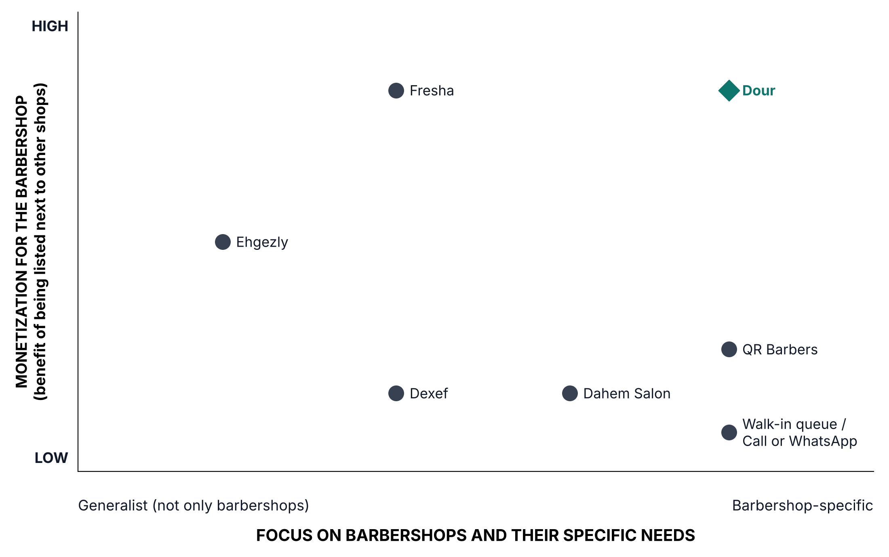

# Milestone 1: Project Idea & Business Model Canvas

## Founders' Contribution Table (1 Page)
| Founder Name | Role | Deliverables & Sections Owned | % Contribution |
| :--- | :--- | :--- | :--- |
| Nooreldeen | CEO / Product owner | 1.1 Section 1 (Vision and Mission), Section 3 (Customer Discovery, all 6 interviews), Section 9 (Company Type and Founding Structure); Deliverable 1.2 (Business Model Canvas and Pricing Hypothesis); Appendix A (Interview Log); Appendix B (Cap Table) | 36.7% |
| Abdelrahman | CTO | 1.1 Section 2 (Problem and Customer), Section 7 (Product-Market Fit Plan), Section 8 (Product Strategy and MVP); Deliverable 1.4 (Investor One-Pager); Appendix C (Generative AI Disclosure); memo assembly and consistency fixes | 32.9% |
| Ahmed | COO | 1.1 Section 4 (Market Sizing), Section 5 (Market Structure and Competition, positioning map), Section 6 (Differentiation and Moat); Deliverable 1.3 (Riskiest Assumptions) | 30.4% |

*% Contribution is calculated in `Founders Contribution Table.xlsx` (weighted scores for idea, business model, domain expertise, commitment and risk, and responsibilities).*

---

## Deliverable 1.1: Founding Memo (Max. 12 Pages, Excluding Appendices)

### 1. Vision and Mission
* **10-Year Vision:** To become the marketplace for barbershops and salons across MENA, where customers find the right barber, every chair is visible, every wait is predictable, and no customer is lost.
* **Daily Mission:** Every day, through our barbershop marketplace, we help customers find a barber and show them the live wait for their own barber, or let them book him for a slot sized to their service (about 30 minutes for hair, 20 for a beard), so they arrive just in time. Shops keep their queue fair, replace their paper logs and reach new customers.

#### How the Mission Leads to the Vision
* **Today (Cairo barbershops, on a marketplace for barbershops only):** Live per-barber wait, plus the automatic service log that replaces the front desk's paper.
* **Next:** Service-based booking with a specific barber, introduced shop by shop once owners see that visible bookings stay fair to walk-ins.
* **In 10 years:** Salons and grooming businesses across MENA, running their queues, bookings and records on one marketplace, where customers find them and barbers carry their reputation from shop to shop.

#### Why It Fits Our Evidence
* **"Their own barber":** Customers are loyal to one barber, and walk-outs happen while other barbers are free.
* **"Live wait" first:** Both shops we interviewed refuse reservations, because it is unfair to customers who arrived first. We intend to change that policy, not work around it. Our answer to the fairness objection:
  - Every booked slot is visible on the front-desk queue and client phones (and later on waiting-area TV screens), so walk-ins see why someone goes ahead;
  - Bookings only fill a barber's free time; and
  - A small deposit discourages no-shows.
  *(Overcoming this fairness objection is a key business model assumption—ranked among our top riskiest assumptions in Deliverable 1.3—so we validate willingness to pay and deposit mechanics before building full advance booking).*
* **"Slot sized to their service":** A haircut and a beard take different times, so slots and wait estimates are calculated per service instead of a flat appointment length.
* **"Replace their paper logs":** Shops record every service per barber by hand and pay for no software today.

### 2. Problem and Customer

* **Problem Description:**
  The urban men's grooming sector in Egypt suffers from severe queue imbalances and operational blindness driven by intense loyalty to individual craftsmen rather than shop brands.

  * **Who Has the Problem (Three-Sided Ecosystem):**
    * **1. The Primary Buyer (Barbershop Owner-Operator):** Owners of multi-chair, upper-mid barbershops suffer from revenue leakage and blind operations. Customer demand bunches heavily on 1–2 popular star barbers while other chairs sit idle. Relying entirely on manual paper ledgers and uncoordinated walk-ins, owners cannot track retention, measure walk-outs, or manage peak-hour floor chaos.
    * **2. The Service Provider (The Individual Barber):** Skilled craftsmen face constant friction during shifts. Regulars call and message them while they are actively holding shears, breaking their workflow. Barbers experience extreme physical fatigue during unmanaged arrival spikes, have zero tools to pace their workday, and possess no formal, portable digital record of their cutting volume, client ratings, or social media craftsmanship.
    * **3. The End-User (The Loyal or High-Intent Client):** Young men and professionals who demand a cut from *their designated barber*—either through long-term loyalty or social media discovery (e.g., TikTok/Instagram transformation reels). They face total "wait blindness" before arrival. Arriving to an unexpectedly packed shop, they face an unacceptable dilemma: waste 30–60 minutes in a crowded waiting area, or walk away and forfeit their grooming routine.
  * **Frequency:**
    * **Daily & Peak-Bunched:** Severe congestion occurs daily, clustering during evening hours (6:00 PM – 11:00 PM), Thursdays, Fridays, and pre-holiday seasons.
    * **Constant Communication Friction:** Front-desk receptionists field 5–10 calls per busy shift exclusively answering *"Is [Barber X] free?"*, while individual barbers receive ~5 direct WhatsApp messages and calls mid-service every day.
  * **Current Solutions & Workarounds:**
    * *Blind Walk-Ins & Lobby Guesswork:* Clients arrive unannounced; seeing 2–4 people waiting ahead for their barber, they either endure an uncomfortable 30–60 minute wait or leave.
    * *Disruptive Direct Messaging:* Regulars text or call barbers directly to negotiate informal timing, forcing barbers to stop cutting or answer with hands full.
    * *Strict First-Come, First-Served Dogma:* Because traditional booking apps cause later arrivals to cut in front of waiting walk-ins, shops strictly reject reservations to avoid customer conflict and maintain shop-floor fairness.
    * *Pen-and-Paper Registers:* Receptionists or senior barbers track services manually in paper notebooks, resulting in zero retention analytics, vulnerability to cash reconciliation errors, and untracked client walk-outs.
  * **Cost of the Problem:**
    * **Direct Revenue Loss for Owners:** Field discovery confirms walk-outs occur daily. At Shop 1's baseline (120 EGP/haircut), losing just 3 walk-away clients per day costs **360 EGP per day, ~10,800 EGP per month, or ~130,000 EGP annually** in unrecoverable top-line revenue per shop.
    * **Staff Productivity Drain:** Front desks lose 30–50 minutes per shift handling repetitive availability calls that fail to convert into visits.
    * **Lost Social Media Conversion:** High-intent prospective clients who view a barber's viral transformation on TikTok/Instagram hit a dead end without a direct link to check real-time availability or queue status.
    * **Client Time & Friction Cost:** Loyal customers lose 30–60 minutes per visit in unproductive waiting or incur wasted round-trip commutes when forced to walk out.

* **Ideal Customer Profile (ICP):**
  * **1. Economic Buyer ICP (Barbershop Owner-Operator):**
    * *Geography & Density:* High-density urban commercial hubs in Greater Cairo, launching in **New Cairo and Nasr City**.
    * *Shop Capacity & Pricing:* Multi-chair shops (**3 to 8 chairs**) charging **100 to 250 EGP per haircut**, where individual barber talent drives repeat business.
    * *Operational Profile:* Uses manual paper logs, enforces strict first-come, first-served queueing, uses smartphones/tablets, and seeks to eliminate walk-outs without disrupting shop floor fairness.
  * **2. Service Provider ICP (The Craftsman / Barber):**
    * *Profile:* Barbers aged 20–35 with an established regular following, active social media presence (posting cuts on Instagram/TikTok), paid on commission or chair rental, seeking to pace their energy and build a portable reputation.
  * **3. End-User ICP (The Loyal / High-Intent Client):**
    * *Demographics:* Men aged **18 to 35** (students and urban working professionals) in Greater Cairo.
    * *Behavior & Tech Profile:* App-literate smartphone users strongly loyal to one specific barber who demand schedule predictability and refuse to sit in another barber's chair.

* **Job-to-be-Done (JTBD) Statements:**
  * **Buyer JTBD (Shop Owner):**
    > *"When customer demand bunches on popular barbers or rushes in from social media, I want to make our live queue transparent and automate daily service logs, so I can eliminate walk-away losses and run an orderly, fair shop without hiring extra staff."*
  * **Provider JTBD (Individual Barber):**
    > *"When I am working busy shifts, I want to minimize phone call interruptions and control my queue flow, so I can focus on my craft, pace my physical energy, and build a verified reputation that stays with me."*
  * **End-User JTBD (Loyal / High-Intent Client):**
    > *"When I need a haircut from my designated barber (or discover him on TikTok), I want to see his real-time queue length before heading out, so I can arrive just in time, skip the 45-minute wait, and never have to settle for another barber."*

### 3. Customer Discovery

To validate the core problem and test our initial hypothesis, we conducted **6 customer discovery interviews** across both sides of the market: 4 on the supply side across two barbershops (2 barbers, 1 front-desk receptionist, and 1 owner) and 2 on the demand side with customers.

Following ***The Mom Test*** principles, we strictly avoided pitching our idea upfront and asked about specific, recent past behavior (*"the last busy day"*, *"the last time someone left"*), not hypothetical opinions. Where answers were vague (*"a lot"*), we asked for concrete numbers and recent examples. Statements about future intentions were flagged as weak evidence. Interviews were conducted in Egyptian Arabic, framed neutrally as a GUC academic research project: *"I'm a GUC student doing a project on barbershops. I'm not selling anything."*

| Segment | Interviews | Setting / Profile |
|---|:---:|---|
| **Barber** | 2 | Shop 1 (multi-chair, front desk), Shop 2 (peer-managed, no front desk) |
| **Front-desk receptionist** | 1 | Shop 1 |
| **Shop owner** | 1 | Shop 1 |
| **Customer** | 2 | Customer 1 (loyal to a specific barber), Customer 2 (no preferred barber) |

* **Interview Guide:** (*The Mom Test* principles — past behavior, not opinions)

  **Barbers (Shop 1 & Shop 2)**
  1. Tell me about the last busy day. How did you know whose turn it was?
  2. Are there barbers people ask for by name? When was the last time people waited for one barber while others were free?
  3. When was the last time someone left because the wait was too long? Do they come back, or go elsewhere?
  4. Do customers call or WhatsApp you before coming? Roughly how many times a day?
  5. Do you ever book someone an appointment? What happens if someone asks you to?
  6. When customers call while you're working, how do you answer?
  7. Has the shop ever used an app for bookings or the queue? What happened?

  **Front Desk (Shop 1)**
  1. Tell me about the last really busy day. How did you track the order? How many people called asking about a wait?
  2. When someone calls about a specific barber, what do you tell them?
  3. Have you ever taken reservations by phone? Why do you work first come, first served?
  4. When you tell a caller the barber is busy, what does he do next?

  **Shop Owner (Shop 1)**
  1. When did someone last leave because the barber they wanted was busy? How many do you lose like that per week?
  2. How much is a haircut? A beard?
  3. Why did you choose no reservations?
  4. Do you pay monthly for any software or app for the shop?
  5. *(Tested only at the very end)* If we built a screen showing the wait for each barber, with no reservations and no line-skipping, would you try it?

  **Customers (Demand Side)**
  1. Tell me about your last haircut. When did you go, how did you choose that time, and how long did you wait?
  2. Before going, did you call the barber or the shop? Why or why not?
  3. When did you last leave without a haircut because of the wait? What did you do after?
  4. Have you ever used an app to book anything? What happened?

* **Summary of Findings:**

  > **Core Insight:** The core problem is **customer loyalty, not shop capacity**: regulars wait for or leave one popular barber while other barbers sit idle.

  | # | Finding | Field Evidence | Heard From |
  |---|---|---|---|
  | **1** | **Demand bunches on 1–2 popular barbers while others are idle** | Popular barbers have 2–4 people waiting. *"Just now I was giving someone a haircut and another was waiting for me while the whole shop was free."* | Barber 1, Barber 2, Owner |
  | **2** | **Customers walk out daily, and nobody counts it** | Owner: walk-outs happen *"always"*, number unknown. Some return later or the next day; some never return. | Barber 1, Barber 2, Owner, Customer 1 |
  | **3** | **Customers already use a manual workaround: calling to ask "are you free?"** | 5–10 calls per busy day to the front desk; about 5 a day to one popular barber; regulars have barbers' phone numbers. | Front desk, Barber 1, Barber 2 |
  | **4** | **Customers who don't call just guess, and guess wrong** | Customer 1 went in the morning *"thinking he'd be free"* and waited ~30 minutes. | Customer 1 |
  | **5** | **Both shops refuse reservations as strict policy** | The owner's rationale is fairness: a customer who arrived first should not see a later arrival skip ahead. | Front desk, Owner, Barber 2 |
  | **6** | **Shops keep records by hand and pay for no software** | Front desk logs every service per barber on paper; at Shop 2 another barber takes payment and logs the service (shop policy). | Front desk, Owner, Barber 2 |
  | **7** | **The wait-time pain belongs exclusively to loyal customers** | Customer 2 has no preferred barber and waited 0 minutes. | Customer 2 |
  | **8** | **Phone and app habits already exist** | Barbers answer phones during cuts. Both customers book padel or football courts by app; one also books doctors. | Barber 1, Barber 2, Customers 1–2 |

  * **Prices & Illustrative Loss:** Shop 1 charges 120 EGP for a haircut, 70 EGP for a beard, 170 EGP for both. Losing 3 haircut customers a day to walk-outs equals **360 EGP a day, about 10,800 EGP a month** in lost revenue.
  * **Willingness to Pay Reality Check:** The owner stated, *"Of course I'd even pay for a service like that,"* and was open to a free trial. We treat this as stated opinion rather than committed budget, since the shop currently spends nothing on software.

* **Invalidated Assumptions & Surprises:**

  Our primary assumption—that shops want customers to book a specific barber in advance—was **invalidated**. We pivoted our MVP from advance time-slot booking to **live wait visibility**.

  | Assumption Before Interviews | What We Learned (Field Evidence) | What We Changed (Strategic Pivot) |
  |---|---|---|
  | **Shops want customers to book a barber in advance** | Both shops refuse reservations as policy. The owner says it is unfair to customers who arrived first. | **MVP shows a live per-barber wait** (*"2 waiting for [barber], about 40 minutes"*) and never changes arrival order. Booking with a specific barber comes later, introduced shop by shop once owners see that visible bookings stay fair to walk-ins (see [Section 1](#1-vision-and-mission)). |
  | **Long waits come from too few barbers** | Waits come from loyalty: regulars wait for one barber while others are free. | **Wait is shown per barber**, not aggregated per shop. |
  | **All young male customers feel the pain** | Customers with no preferred barber barely wait; they take whoever is free. | **ICP narrowed to loyal customers** who wait for one specific barber. |
  | **Customers who leave are lost for good** | At Shop 2 most leavers ask *"when will you be free?"* and return then. At Shop 1 some never return. | **Add queue alerts:** The cost is wasted trips and delay as much as lost revenue. Added a *"your barber's queue is short"* alert. |
  | **Barbers would manage the app themselves** | Shop 1 already has a front desk that logs every service on paper; Shop 2 delegates payment to a peer barber. | **Dual staff logging:** The front desk, or the designated cashier barber, marks services done. Auto-calculated totals per barber replace paper ledgers. |
  | **Barbers want customers to see their queue at all times** | Barber 2 decides whether to take another customer based on how much energy he has left. | **Queue control:** Each barber gets an individual *"open / close my queue"* toggle control. |

  **Other Surprises & Limitations:**
  * *Operational Surprises:* The owner has no idea how many customers he loses, and the front desk cannot tell whether a telephone caller later came in. At Shop 2, a peer barber takes payment and logs services to ensure internal control.
  * *Methodological Limitations:* Small sample (2 shops, 2 customers; 3 shop interviews from Shop 1). Customer 1 is the interviewer's brother (potential confirmation bias). Future willingness to pay is stated, not demonstrated. Revenue totals were withheld as confidential by Shop 1.
  * *Next Discovery Cycle:* Expand to at least 2 additional shops in other neighborhoods and arms-length customers to verify if the strict no-reservation policy and loyalty clustering hold universally.

*(Full anonymized raw interview logs with verbatim translated quotes and surprises are provided in [Appendix A: Full Customer Discovery Interview Log](#appendix-a-full-customer-discovery-interview-log).)*

### 4. Market Sizing

**Price used in both methods:** EGP 1,000 per shop per month = **EGP 12,000 per year**.

---

## Top-Down (money)

### TAM = EGP 67.2M
**Calculation:** EGP 12bn × 5.6% × 10% = EGP 67.2M
- **EGP 12bn:** Annual income of Egypt's barber sector, estimated at no less than EGP 12bn by the Cairo Chamber of Commerce's hairdressing division [1].
- **× 5.6%:** Share of a salon's revenue spent on what our product replaces: software for scheduling, POS and CRM (up to 0.6%) plus marketing to win customers which is offered by our marketplace exposure (up to 5%) [2].
- **× 10%:** Only licensed shops can subscribe; about 200,000 of at least 2 million salons are licensed [1].

### SAM = EGP 16.0M
**Calculation:** EGP 67.2M × 23.8% = EGP 16.0M
- **× 23.8%:** We launch in Cairo (10.5M), Giza (9.9M) and Alexandria (5.7M), 26.1M of Egypt's 109.5M people [3].

### SOM = EGP 1.85M
**Calculation:** EGP 16.0M × 11.5% = EGP 1.85M
- **× 11.5%:** Share of SAM captured by Year 3, from the capture plan below (154 shops × EGP 12,000 ÷ SAM).

---

## Bottom-Up (customers × price)

### TAM = EGP 82.2M (6,853 shops)
**Calculation:** 6,853 shops × EGP 12,000 = EGP 82.2M
- **6,853:** Men's barbershops listed with an address and phone in Egypt's Yellow Pages, summed across governorates: Cairo 3,037, Giza 2,519, Qalyubia 540, Alexandria 283, Menoufia 198, Sharqia 74, Kafr El-Sheikh 61, Dakahlia 59, Damietta 42, Fayoum 40 [4].

### SAM = EGP 16.0M (1,330 shops)
**Calculation:** 1,330 shops × EGP 12,000 = EGP 16.0M
- **1,330:** Barbershops with a Google Maps business profile in Cairo (632), Giza (475) and Alexandria (223), meaning they already use technology [5].

### SOM = EGP 1.85M (154 shops)
**Calculation:** 154 shops × EGP 12,000 = EGP 1.85M
- **154 shops:** From the capture plan below.

---

## SOM Capture Plan (used by both)

| Year | Sales effort | New shops | Lost (15% churn) | Active shops |
|---|---|---|---|---|
| 1 | 2 founders, Nasr City and New Cairo | 2/month = 24 | — | 24 |
| 2 | + 1 sales rep, add Giza | 4/month = 48 | 4 | 68 |
| 3 | + 2nd sales rep, add Alexandria | 8/month = 96 | 10 | **154** |

- **How each year is calculated:** Active shops = last year's shops − 15% churn + new shops.
- **Why 8 a month is realistic assumption:** 2 sales reps each sign 1 shop per week.

---

## Reconciliation

| | Top-down | Bottom-up | Gap |
|---|---|---|---|
| TAM | EGP 67.2M | EGP 82.2M | 18% |
| SAM | EGP 16.0M | EGP 16.0M | <1% |
| SOM | EGP 1.85M | EGP 1.85M | — |

Two independent starting points, sector money and named shops, land within 18% at TAM and match at SAM. 
---

## Assumptions
1. **Shop counts come from Yellow Pages Egypt.** Yellow Pages is the national business directory [4], used because no official count of barbershops exists. These counts are a minimum: they miss shops that never listed themselves and may include some that have closed.
2. **EGP 12bn is a minimum.** The Chamber said the sector earns "no less than" EGP 12bn, so the real figure could be higher. The hairdressing division also covers women's salons, so part of that money may not come from barbers [1].
3. **5.6% is the salon spend on software and marketing.** The figures come from Booksy and describe salons in general; Egyptian barbers' actual marketing spend still has to be checked in interviews [2].
4. **10% licensed is for all salons.** The Chamber's 200,000 licensed out of 2 million mixes men's and women's salons. We assume men's barbershops have a similar licensing rate [1].
5. **Shops are spread in proportion to population** across governorates [3].
6. **The Google Maps data is unofficial.** It comes from a private company that collects Google Maps listings and doesn't explain exactly how it collected them. It shows the right order of magnitude but isn't an exact count [5].
7. **EGP 12,000 a year is our own price.** Real willingness to pay still has to be tested with shops.
8. **The sales pace and churn are targets.** Signing 2, then 4, then 8 shops a month, and losing 15% of shops each year, are goals rather than proven numbers. They need to be checked during pilot launches.

---

## Why Now?
Egypt has a huge, recurring market for men's grooming, yet barbershops still run on walk-ins, phone calls and WhatsApp. Customers waste time waiting, and shops lose income from no-shows and idle chairs. Meanwhile, Egyptians already book and pay through their phones for rides, food and doctor visits. Existing booking platforms are generic or foreign and charge commissions on new customers instead of being built for local barbershops, which leaves a clear gap. We fill it with a simple, barber-focused live queue, POS and marketplace app that brings organized, predictable visits to a market that is ready for it.

---

*(Market sizing sources, citations, and reference links are detailed in [Appendix D: Market Sizing Sources & Citations](#appendix-d-market-sizing-sources--citations).)*

### 5. Market Structure and Competition

## Competition List by Tier

| Tier | Competitor | What it does | Why this tier |
|---|---|---|---|
| Direct | Ehgezly [1][2][3] | Egyptian app where customers browse shops and book beauty services, including a barber category. Shops get a dashboard for bookings, calendar, team and revenue. | Customers can choose any listed barbershop and book. |
| Direct | Fresha [9][10] | Global salon marketplace and shop software. 28 barbers listed in Egypt. Customers pick a barber and a time slot online. | Customers can choose any listed barbershop and book. |
| Indirect | QR Barbers [15] | Cairo-built barber booking app where each shop gets its own booking service. | Booking for one shop at a time. Customers cannot compare shops. |
| Indirect | Dahem Salon [16] | B2B system with a men's barbershop edition: appointments, waitlist, chair status, commissions, customer records. | The shop gets its own booking link. No cross-shop marketplace. |
| Indirect | Dexef [17] | Accounting, ERP and POS vendor with salon software: scheduling, commissions, customers, POS, inventory. | B2B accounting and POS. No customer platform. |
| Substitute | Walk-in queue [18] | Customer arrives and waits for a turn. | Barber does no online booking. |
| Substitute | Call or WhatsApp [19] | Customer and barber agree a time by message or call, and the barber confirms manually. | Barber does no online booking. |

## Competition Matrix: Direct Competitors

| | Ehgezly | Fresha |
|---|---|---|
| **Summary** | Egyptian app where customers book beauty and wellness services: barbers, hair and nails, laser, makeup, massage, pet services [1]. The barber category lists 9 shops, all in New Cairo (7 brands; La Casa and Luka each have 2 branches) [2]. Shop owners get a dashboard for bookings, calendar, team and revenue [3]. | London-based global booking marketplace plus shop software [12]. Egypt barber page: 28 barbers and 10 professionals in Cairo, Giza, Ismailia and Damietta, with an average rating of 4.0 from 9,892 reviews [9]. Customers pick a specific barber or any professional and book in 5-minute slots [10]. |
| **Target customers** | Customers: people in Cairo booking beauty services [2]. Shops: barbershops, salons and clinics [3]; its FAQ says any small business [4]. | Customers: people searching for local services [9]. Shops: salons, spas, barbershops, solo barbers and small teams [14]. Direct sales for large multi-branch businesses [12]. |
| **Product or service pricing** | Customers pay the shop's listed price in EGP. Haircuts range from 150 to 290 EGP, and 6 of 9 shops charge 250 [2]. Shop-side fees, commission and subscription are not published [3][8]. Refunds take 5 to 7 business days under the shop's policy [4]. | Customers pay the shop's listed price in EGP. Haircuts range from 80 (Gedo Salon) [9] to 320 (Shad's Men's Salon) [10]. Shops pay (USD list prices) [11]: Independent USD 19.95 a month; Team USD 14.95 per barber a month; online card payments 2.79% + USD 0.20; in-person 2.29% + USD 0.20; a 20% one-time fee (minimum USD 6) on each new customer found through the marketplace. Booking through the shop's own link, Instagram or Facebook is free [11]. Whether Egypt shops are billed in EGP is not stated [11]. |
| **General marketing strategy** | Almost no public marketing so far. Shop-side pitch: "Goodbye WhatsApp chaos", "fill empty hours" with 24/7 booking, "get paid automatically" [3]. Free onboarding in Arabic and English, Cairo phone support (Sat to Thu, 10:00 to 20:00), WhatsApp chat, AI assistant [3][5]. Positions itself as built in Egypt [3]. | Free-to-start pitch, with paid plans added in 2025 [12]. The marketplace brings new customers and Fresha charges a fee on the first booking only [11][12]. Creator posts with working stylists and barbers. Claims shops get 26% more customers and a 392% return (third-party study, not independently checked) [12]. Self-serve sign-up with a 7-day trial for small shops [11][12]. |
| **Online marketing strategy** | Instagram: 11 followers [6]. Facebook: 1 follower, one post, 0 reviews [7]. A blog page exists; posts not read [1]. Website and apps are the main channel [1]. | Heavy Google advertising: about 2,000 Search ads, with automated per-shop ads in several languages [12]. Instagram about 80,000 followers; TikTok and LinkedIn active; no active Meta or TikTok ads [12]. Arabic platform live since 2025 [13]. Middle East push targets the Gulf (Dubai and Saudi teams; Qatar, Oman and Kuwait next), and Egypt is not mentioned [13]. |
| **Strengths** | Egyptian company with local support in Arabic and English [3][5]. Prices in EGP [2]. Online payment at booking and refunds [3][4]. Reminders and reviews [3]. Dashboard for bookings, team and revenue [3]. | Large review base in Egypt: Rashed's Studio 3,205 reviews, Shad's Men's Salon 1,691, Gedo Salon branches 356 to 1,392 [9][10]. Customers choose barber and slot online [10]. Full toolset: waitlist, deposits, POS, memberships, reports [14]. Strong global brand [12]. |
| **Weaknesses** | Few barbers: 9 in one area [2], though its partner form says "thousands of shops" [8]. Not barber-focused: pet clinics and women's salons sit on the same app [2]. Almost no social following [6][7]. Deposit and no-show rules not stated [3][4]. | The 20% fee on new customers plus processing fees add up [11][14]. No Egypt-specific marketing found [13]. Phone support is a paid add-on on the Independent plan [14].  Not barber-specific [9]. |
| **Competitive advantage** | Local: Egyptian team, EGP, Arabic and Cairo-hours support [3][5]. | Already has shops and thousands of reviews in Egypt, plus a complete product [9][10][14]. |
## Positioning Map



## References
- [1] Ehgezly, home page. <https://ehgezly.app/>
- [2] Ehgezly, barber listings. <https://ehgezly.app/service/barber>
- [3] Ehgezly, for salons and clinics. <https://ehgezly.app/for-business>
- [4] Ehgezly, FAQ. <https://ehgezly.app/faq>
- [5] Ehgezly, contact. <https://ehgezly.app/contact>
- [6] Ehgezly, Instagram (@bookwithehgezly). <https://www.instagram.com/bookwithehgezly/>
- [7] Ehgezly, Facebook page. <https://www.facebook.com/share/184zUxhmEW/?mibextid=wwXIfr>
- [8] Ehgezly, list your business form. <https://ehgezly.app/ListUrBussiness>
- [9] Fresha, Egypt barber page. <https://www.fresha.com/lp/en/bt/barbers/in/egypt>
- [10] Fresha, Shad's Men's Salon page and booking flow. <https://www.fresha.com/a/shads-mens-salon-cairo-governorate-shads-mens-salon-el-montaza-el-fath-fsxsilpl>
- [11] Fresha, pricing. <https://www.fresha.com/pricing>
- [12] Milk and Cookies, "Marketing Spotlight: Mapping Fresha's Marketing and Sales Tactics" (third-party study). <https://milkandcookies.studio/market-intelligence/marketing-spotlight-fresha-marketing-sales-tactics/>
- [13] Fresha, "Fresha continues to expand across the GCC", 1 July 2025. <https://www.fresha.com/blog/expanding-in-the-GCC>
- [14] Pabau, Fresha review (written by a competitor). <https://pabau.com/blog/fresha-review/>
- [15] QR Barbers, Google Play listing. <https://play.google.com/store/apps/details?id=com.qrbarbers.app&hl=en_US>
- [16] Dahem, salon system. <https://dahem.cloud/salon>
- [17] Dexef, beauty center management software. <https://dexef.com/apps/beauty-center-management-software>
- [18] Codeiks, barber shop software page (vendor description, not independent data). <https://www.codeiks.com/blog/barber-shop-software-egypt>
- [19] The Barber, New Cairo, online booking page. <https://thebarber-eg.com/en/blog/online-booking-grooming-lounges-egypt>
### 6. Differentiation and Moat
## Differentiators

Current options fall into three groups: general beauty platforms (Fresha, Ehgezly), single-shop booking tools (Dahem Salon, QR Barbers, Dexef), and the status quo (walk-ins, calls and WhatsApp). None of them combines the three points below.

### 1. A marketplace for barbershops only
Every listing is a men's barbershop. Fresha and Ehgezly list barbers next to salons, spas and other categories, and single-shop tools only show one shop. Here, customers looking for a barber compare barbershops only, and a shop is seen by people who are looking for exactly what it offers. Since it focuses strictly on barbershops, it aggregates barbershop supply far more effectively than generic beauty platforms, creating an irreplaceable vertical network effect. This unlocks higher monetization, organic discovery, and targeted marketing exposure for barbershops on top of the queue and management software. 

### 2. Ratings for each barber, not just each shop
Customers rate both the shop and the barber who cut their hair. In a barbershop, people choose the barber, so a skilled barber builds his own reputation and attracts customers by name. On general platforms, reviews sit on the business profile, and single-shop tools have no public reviews. Shops with good barbers will be exposed and rewarded on a larger scale than just word of mouth. Also barbershops will be able to assess their staff and know who to keep and who to let go.

### 3. Barber profiles that move with the barber
In Egypt, barbers often move between shops, and loyal customers follow the barber, not the shop. Each barber has his own profile with his ratings, photos of his work and his customers. If he moves to another shop on the platform, his reputation moves with him and his customers can find him. General platforms tie everything to the business, and single-shop tools lose the barber's history when he leaves.

**Why it matters for barbershops:**
- **Scouting proven talent.** A shop owner can find skilled barbers on the platform by their real ratings and work, instead of hiring on word of mouth.
- **Hiring brings customers.** A barber who joins a shop brings his reputation and his loyal customers with him, so the shop gains revenue from day one.
- **Lower hiring risk.** The owner sees a barber's track record before hiring him, not after.

### Why this is hard to copy as a whole
Since there is no platform for barbers only, this can be something completely new for barbershops and customers. It helps them with live queue visibility and streamlined front-desk logging (with advance booking unlocked once fairness is established), reducing lost profits from clients who leave because of traffic. In addition, the platform offers monetization and exposure to barbershops, helps with talent acquisition, and rewards shops that have high-quality barbers, helping in marketing and human resources operations for barbershops. This combination is not offered anywhere in Egypt which is exactly why our product stands out.
## Moat

### 1. Switching costs

Once a barbershop runs on the platform, leaving means losing what it has built:

- **Its reputation.** The ratings and reviews of the shop and each of its barbers stay on the platform. On a competitor's app, the shop starts again from zero next to shops with hundreds of reviews.
- **Its booking customers.** The shop would have to convince every regular who books online to download a new app and book there instead. Many won't, and some will book another shop that is still on the platform.
- **Its history.** Months of data on revenue, barber performance and customer visits stay behind, so the owner loses the record he uses to manage his team.

**Why it protects us:** a competitor would have to offer a shop enough to make up for losing its reputation, its booking customers and its history, which is very hard to do.

### 2. Network effects

The platform gathers both sides of the market in one place: many barbershops (supply) and a large customer base (demand).

- **Each side keeps the other.** Customers come because the shops are here, and shops stay because the customers are here.
- **It becomes the standard.** The more shops and customers join, the more the platform becomes the default place to find and book a barber, so even more people join.
- **Reviews build up with use.** Every visit adds ratings that a new platform cannot copy or buy.

**Why it cannot be copied:** a competitor can copy the features, but not the network. A new platform starts with no shops, no customers and no reviews, and has to compete with a platform that already has supply and demand. No shop wants to move first and lose its customers, and no customer wants to move first and find few shops. Gathering both sides from scratch takes years and a large budget.

### 7. Product-Market Fit (PMF) Plan

Following the three-part framework from market analysis (Survey predicts, Process improves, Behaviour proves):

* **PMF Verification Method:**
  * **1. Survey (Predicts) — The Sean Ellis Test:**
    * Survey active users after 30 days (clients who checked queue $\ge 2$ times; shop owners/cashiers running the queue screen daily):
      > *"How would you feel if you could no longer use this platform tomorrow?"*  
      > *(A) Very disappointed &nbsp;&nbsp;|&nbsp;&nbsp; (B) Somewhat disappointed &nbsp;&nbsp;|&nbsp;&nbsp; (C) Not disappointed*
  * **2. Process (Improves) — The Superhuman PMF Engine (Rahul Vohra):**
    * **Segment:** Profile users who answer "Very disappointed" to isolate our core ICP (loyal clients who visit a specific barber every 2–4 weeks; multi-chair shops with 3–8 chairs).
    * **Analyze:** Identify what fans love (e.g., real-time barber queue visibility, zero walk-outs) vs. what holds back the "somewhat disappointed" group.
    * **50/50 Roadmap:** Allocate 50% of development to doubling down on what fans love and 50% to resolving core friction for "somewhat disappointed" users.
    * **Repeat:** Re-survey cohorts monthly to track score progression.
  * **3. Behaviour (Proves) — Flattening Retention Curves:**
    * Measure cohort retention over time to confirm a loyal core stays without push notifications:
      * **Client Cohorts:** 30, 60, and 90-day repeat queue check-in rates (tracking the natural 2–4 week haircut cycle).
      * **Shop B2B Cohorts:** Monthly active shop usage and subscription renewals.
  * **4. Pull Signals:**
    * Measure organic word-of-mouth (clients sharing live queue links with friends) and inbound requests from neighboring barbershops.

* **Target Thresholds:**
  * **Sean Ellis Score:** $\ge 40\%$ "Very disappointed" among surveyed active clients; $\ge 50\%$ among shop owners/cashiers.
  * **Client Cohort Retention:** 60-day cohort curve flattens at $\ge 35–40\%$ repeat active users.
  * **Shop B2B Retention:** Monthly shop churn $< 1.3\%$ (maintaining our SOM assumption of $< 15\%$ annual churn).
  * **Workflow Stickiness:** $\ge 85\%$ of all daily cuts logged digitally on the screen rather than paper ledgers.
  * **Operational Pull:** $\ge 60\%$ of queue views occur during peak hours (6:00 PM – 11:00 PM) before in-person arrival. 

### 8. Product Strategy and MVP

* **MVP Scope:** (Designed to test the riskiest operational and commercial assumptions from Deliverable 1.3)
  The MVP is designed to test our core operational assumption (Deliverable 1.3, Assumption #4): **that shop staff will reliably maintain an accurate digital queue throughout the day in real time, and customers will use live per-barber wait visibility to arrive just in time instead of walking out**, while simultaneously verifying shop willingness to convert to a paid subscription (Deliverable 1.3, Assumption #1). If staff abandon the tool during peak rushes or wait times desync, the queue becomes inaccurate and the platform loses all customer trust.

  To test this, the MVP is deployed across 2–3 busy multi-chair barbershops (3–8 chairs) in New Cairo and Nasr City over a 4-week pilot, focusing strictly on the operational queue loop and paper replacement before building out the wider marketplace.

  * **What is IN the MVP:**
    - **Front-desk tablet web app:** Quick walk-in entry (<15 seconds), one-tap chair seating and finish toggles, and an automatic daily cut and cash log per barber that directly replaces the manual paper register.
    - **Consumer mobile web app:** Lightweight responsive web link (accessible via QR code or direct link with zero app store download friction) showing real-time per-barber wait status and letting clients join the queue remotely.
    - **Barber queue pause toggle:** Simple open/pause control per barber to take breaks and manage physical fatigue.
    - **Real-time synchronization backend:** WebSocket engine keeping the front-desk tablet and customer phones in sync in under 2 seconds.
    - **Concierge deposit booking test:** Lets customers reserve advance slots with popular barbers by sending a 30–50 EGP deposit via InstaPay or mobile wallet, credited at counter checkout.

  * **What is OUT of the MVP (Deliberately Deferred):**
    - *In-shop waiting room TV screen:* A luxury display that can wait. Customers check their own phones, avoiding hardware installation friction during early pilots.
    - *Native iOS/Android store apps:* Web app removes download resistance and avoids app store approval delays during pilot testing.
    - *Automated payment gateway:* Pilot uses direct InstaPay / mobile wallet concierge transfers to avoid merchant onboarding delays.
    - *Retail product inventory tracking:* Hard to implement with minimal payoff; Egyptian barbershops earn >95% of revenue from services.
    - *AI wait time predictions:* Simple fixed buffers (30 min haircut, 20 min beard) are used instead of machine learning algorithms.
    - *City-wide marketplace directory:* The pilot runs shop-by-shop via direct links and QR codes before launching public cross-shop discovery.

  * **Pilot Pass/Fail Metrics:**
    - **Queue Accuracy & Adoption:** Staff log at least 85% of walk-ins within 2 minutes of arrival, and close at least 90% of completed cuts through the tablet.
    - **Speed & Usability:** Front-desk walk-in entry takes 15 seconds or less; customer checks queue or books unaided in under 1 minute.
    - **Technical Sync:** Real-time queue updates appear on all screens in under 2 seconds with zero double-booking errors over 100+ visits.
    - **Commercial Conversion:** At least 2 of the 3 pilot shops agree to transition to the paid 1,000 EGP/month subscription at the end of the 30-day trial.

* **Feature Prioritization (Top 20 Features):**

  | # | Feature Name | Target User | MoSCoW | Kano Category | Why It Matters |
  |---|---|---|---|---|---|
  | **1** | **Quick walk-in entry (<15s)** | Front Desk / Cashier | **Must-Have** | **Basic** | Replaces paper notebook; must be faster than handwriting or staff abandon it during peak hours. |
  | **2** | **One-tap chair seat and finish toggles** | Front Desk / Cashier | **Must-Have** | **Basic** | Frees chairs and updates the live queue with one touch; keeps staff hands-off clunky menus. |
  | **3** | **In-shop waiting room TV screen** | Waiting Clients & Staff | **Could-Have** | **Delighter** | A luxury display that can wait. Customers check queue status on their phones, so a dedicated TV is not needed for launch. |
  | **4** | **Live per-barber queue tracker** | Customer | **Must-Have** | **One-Dimensional** | Shows live wait per barber (*"2 ahead, ~40 min"*); eliminates blind waiting and stops walk-outs. |
  | **5** | **Barber queue pause/open toggle** | Barber | **Must-Have** | **Basic** | Gives barbers control over physical fatigue and shift pacing so they can pause incoming clients. |
  | **6** | **Automated daily cut & cash ledger** | Shop Owner & Cashier | **Must-Have** | **One-Dimensional** | Instantly sums daily cuts, services, and cash per barber; replaces manual paper accounting. |
  | **7** | **Real-time multi-device sync (<2s)** | System / All | **Must-Have** | **Basic** | WebSockets keep front desk and customer phones in sync with no delay or double-booking. |
  | **8** | **SMS / WhatsApp proximity alerts** | Customer | **Should-Have** | **One-Dimensional** | Alerts customer when 1 person is ahead so they arrive just in time without sitting in the lobby. |
  | **9** | **Deposit-backed advance slot booking** | Customer & Shop | **Should-Have** | **One-Dimensional** | Collects 30–50 EGP deposit via InstaPay/wallet to guarantee slot and eliminate no-shows. |
  | **10** | **In-app checkout with deposit deduction** | Front Desk & Customer | **Should-Have** | **Basic** | Built directly into tablet with no dedicated POS needed; automatically deducts prepaid deposit from final bill. |
  | **11** | **Dynamic service duration buffers** | Front Desk & Customer | **Should-Have** | **One-Dimensional** | Sizes slots by service (30m hair, 20m beard) with small buffers to prevent floor bottlenecks. |
  | **12** | **Verified dual-axis review system** | Customer, Shop & Barber | **Should-Have** | **Delighter** | Review prompt unlocked only after completed cut ticket, rating Shop Ambiance (1–5) and Barber Skill (1–5). |
  | **13** | **Barber portable profile & social showcase** | Barber & Customer | **Should-Have** | **Delighter** | Barber portfolio with verified cut stats, skill tags, and Instagram/TikTok transformation video links. |
  | **14** | **Late arrival 10-minute grace release** | System & Front Desk | **Could-Have** | **Basic** | Auto-releases an advance slot to walk-ins if customer is >10 min late, forfeiting the deposit. |
  | **15** | **Barbershop discovery & geo-search directory** | Customer | **Could-Have** | **One-Dimensional** | Search and filter barbershops by neighborhood (New Cairo, Nasr City), price, and live wait time. |
  | **16** | **Smart cut-cycle reminder engine** | Customer & Barber | **Could-Have** | **Delighter** | Automated reminder sent every 2–4 weeks based on past haircut frequency to bring customers back. |
  | **17** | **Automated monthly SaaS billing** | Shop Owner & Platform | **Could-Have** | **Indifferent** | Recurring billing system charging 1,000 EGP/month subscription to shop owners. |
  | **18** | **Multi-chair shop owner analytics** | Shop Owner | **Could-Have** | **One-Dimensional** | Dashboard tracking saved walk-outs, chair utilization rates, and barber revenue. |
  | **19** | **AI dynamic wait prediction** | Customer & System | **Won't-Have** | **Delighter** | Machine learning model predicting wait times; deferred because fixed service buffers work well enough. |
  | **20** | **Retail product inventory & stock tracking** | Shop Owner & Platform | **Won't-Have** | **Indifferent** | Tracking shelf retail products (waxes, oils); hard to implement with zero early payoff since services drive >95% of revenue. |

* **Roadmap (Now / Next / Later for 6–12 Months):**

  ```mermaid
  flowchart LR
      subgraph NOW["NOW: Months 1–3 (Q1)"]
          direction TB
          N1["Operational Core & Live Queue MVP"]
          N2["Front-Desk Tablet Quick Logging (<15s)"]
          N3["Consumer Web Live Queue Tracker"]
          N4["Barber Queue Pause / Open Control"]
          N5["2–3 Pilot Shops Validated"]
      end

      subgraph NEXT["NEXT: Months 4–6 (Q2)"]
          direction TB
          X1["Commercial Rollout: 6–8 Active Shops"]
          X2["Payment Gateway for 30–50 EGP Deposits"]
          X3["In-App Checkout Deposit Deduction"]
          X4["Automated WhatsApp / SMS Arrival Alerts"]
          X5["1,000 EGP/mo B2B Paid Subscription"]
      end

      subgraph LATER["LATER: Months 7–12 (Q3-Q4)"]
          direction TB
          L1["Year 1 SOM Target: 20–24 Active Shops"]
          L2["Consumer Marketplace Discovery Directory"]
          L3["Barber Portable Identity & Video Portfolios"]
          L4["10–15% Marketplace Commission Launch"]
          L5["Cut-Cycle Automated Reminders (2–4 wks)"]
      end

      NOW --> NEXT --> LATER
  ```

  * **NOW: Months 1–3 (Q1) — Live Queue & Operational Core (MVP Validation)**
    * **Goal:** Prove shop-floor adoption in 2–3 pilot shops in New Cairo and Nasr City, replace paper logs, and keep the live queue accurate.
    * **Deliverables:**
      - Front-desk tablet web app (quick walk-in entry under 15s, seat/finish chair buttons, automatic daily cut tally).
      - Barber queue pause/open buttons to manage shift fatigue.
      - Consumer mobile web app for checking per-barber wait times and remote queue check-in (no app download needed).
      - Real-time WebSockets backend syncing tablet and customer phones in under 2 seconds.
      - Concierge InstaPay deposit test (30–50 EGP) for star barber bookings.
    * **Target Metrics & Exit Gate:**
      - 2–3 pilot shops operating live.
      - At least 85% of daily cuts logged digitally instead of paper.
      - Walk-in entry time under 15 seconds.
      - At least 50% deposit payment rate on advance booking attempts.
      - At least 2 of 3 pilot shops convert to paying 1,000 EGP/month at the end of the 30-day trial.

  * **NEXT: Months 4–6 (Q2) — Commercial Onboarding & Deposit Engine**
    * **Goal:** Begin regular sales onboarding at 2 shops/month, automate deposit payments, and grow to 6–8 active paying shops in New Cairo and Nasr City.
    * **Deliverables:**
      - Payment gateway integration (InstaPay, mobile wallets, credit/debit cards for 30–50 EGP deposits).
      - Front-desk in-app checkout module with automated deposit deduction (no external POS needed).
      - Hybrid queue engine combining walk-ins and reservations with dynamic service buffers (30 min hair, 20 min beard).
      - Automatic 10-minute late grace window and seat release.
      - Automated WhatsApp / SMS queue proximity alerts (*"You are next; arrive in 10 minutes"*).
      - Verified dual-axis review system (Shop Ambiance vs Barber Skill).
      - Automated monthly 1,000 EGP subscription billing.
    * **Target Metrics & Exit Gate:**
      - 6 to 8 active paying shops (on track for Year 1 SOM pace of 2 shops/month).
      - At least 50% deposit completion rate with under 5% no-shows.
      - Monthly shop churn under 1.3% (<15% annual churn).
      - Zero double-booking errors across all active shops.

  * **LATER: Months 7–12 (Q3–Q4) — Marketplace Discovery & Reaching Year 1 SOM**
    * **Goal:** Scale supply to 20–24 active paying shops across New Cairo and Nasr City (achieving our Year 1 SOM target), launch consumer marketplace discovery, and monetize new client bookings.
    * **Deliverables:**
      - Consumer marketplace directory and geo-search across all 24 partnered shops (filter by area, price, rating, and live wait).
      - Barber portable identity and social portfolio (cut stats, style badges, Instagram/TikTok transformation links).
      - Marketplace commission billing (10–15% on new customers who book through the app).
      - Cut-cycle automated reminder engine (alerts every 2–4 weeks based on client frequency).
      - In-shop lounge TV screen display (optional luxury queue board for high-end shops).
      - Multi-branch owner analytics (chair utilization, staff performance, saved walk-outs).
      - Groundwork and sales preparation to add Giza and hire 1 sales rep in Year 2 (to scale toward the 68-shop Year 2 target).
    * **Target Metrics & Exit Gate:**
      - 20 to 24 active paying shops (achieving 100% of the Year 1 SOM goal of 24 shops).
      - Over 300 monthly marketplace bookings earning 10–15% commission.
      - Sean Ellis PMF score: at least 40% "Very disappointed" among surveyed customers; at least 50% among shop owners.
      - 60-day client cohort retention flattens at 35–40%.


---

### 9. Company Type and Founding Structure

* **Company Type Justification:** (Venture-scale vs. SME/lifestyle)
  * **Company Type:** Venture-scale marketplace startup.
  * We are a venture-scale marketplace startup. Three founders split equity 35 / 30 / 25 by role, with 10% reserved for future employees. All shares vest over 4 years with a 1-year cliff, and all IP belongs to the company.
  * **Why venture-scale, not an SME or lifestyle business:**
    * **Software scales cheaply:** Adding a new barbershop costs almost nothing; there is no new staff or location per customer.
    * **Revenue that grows with every shop, then with every new customer:** Each shop pays a monthly subscription of 1,000 EGP, so revenue grows with every shop we add. As our marketplace starts bringing shops new customers, we add a commission on each new customer we bring them, so revenue also grows with marketplace traffic.
    * **A large, expandable market:** We start with Cairo barbershops, then move to salons and grooming businesses across MENA (see [Section 1: Vision and Mission](#1-vision-and-mission)).
    * **A marketplace and data advantage:** Every shop and barber we add makes the marketplace more useful to customers, and every new customer makes it more valuable to shops: a network effect that is hard for a competitor to copy. Every shop also adds data on walk-outs, wait times and barber demand that no shop records today, which improves wait estimates.
    * **The honest counter-argument:** Shops pay for no software today, so 1,000 EGP a month is a new cost they must see a return on. A subscription in one city alone is not venture scale: that depends on signing many shops across MENA and on the marketplace bringing enough new customers to earn a commission. If shops will not pay or the marketplace stays small, this would become an SME, and we will test that before raising money.
    * **Revenue math:** 1,000 EGP per shop per month × number of shops. For example, 10 pilot shops = 10,000 EGP a month (120,000 EGP a year), and 100 shops = 100,000 EGP a month (1.2 million EGP a year). The commission on new marketplace customers comes on top, once the marketplace brings measurable traffic.

* **Founding Roles:** (Including Product Owner)
  | Founder | Role | Owns |
  | :--- | :--- | :--- |
  | **Nooreldeen** | CEO / Product owner | Vision, product decisions and the MVP scope, customer discovery, fundraising. Owns product. |
  | **Abdelrahman** | CTO | Technical architecture, real-time sync backend, front-desk tablet web app, and consumer mobile web app |
  | **Ahmed** | COO | Shop partnerships, onboarding barbershops, operations and support, the next rounds of interviews |

  * **Product Owner Designation:** Nooreldeen owns product because Nooreldeen ran the customer discovery and turned it into product decisions: the move from booking to a live per-barber wait, and the narrower ICP of loyal customers.

* **Founder–Market Fit:**
  We are three GUC students building a software company, and our roles cover the three things it must do well: understand barbershops, build the product, and win shops. Nooreldeen (CEO) has already done the field work: he ran all six discovery interviews across two barbershops, on both the shop and customer side, and turned them into the product's direction. Abdelrahman (CTO) led this milestone's technical deliverables and will build the front-desk tablet web app, consumer mobile web app, and real-time backend. Ahmed (COO) led this milestone's operations deliverables and will run shop partnerships, onboarding and support. Our gap: we are full-time students, so our time is limited, especially during exams, and none of us knows yet how to register a company in Egypt or legally collect monthly subscriptions from shops. We close the first by keeping the pilot small (2–3 shops) and planning the heavy work around the semester, and the second by getting advice from a lawyer and from GUC’s startup support before we register, and by using a licensed local payment provider to collect the subscriptions.

* **Equity Split & Vesting Schedule:** (e.g., 4 years with 1-year cliff)
  * The split is weighted by role, based on responsibility, how hard each role is to replace, and early work done.

  | Holder | Shares | Ownership | Vesting |
  | :--- | :---: | :---: | :--- |
  | **Nooreldeen (CEO / Product owner)** | 3,500,000 | 35% | 4 years, 1-year cliff |
  | **Abdelrahman (CTO)** | 3,000,000 | 30% | 4 years, 1-year cliff |
  | **Ahmed (COO)** | 2,500,000 | 25% | 4 years, 1-year cliff |
  | **Employee option pool** | 1,000,000 | 10% | Set per hire |
  | **Total** | **10,000,000** | **100%** | |

  * **Role Weighting Rationale:**
    * **CEO (35%):** Makes the final product and company decisions, and leads fundraising.
    * **CTO (30%):** Builds the core product; the hardest role to replace.
    * **COO (25%):** Brings in and keeps the shops.
    * **Option pool (10%):** Set aside to hire early employees, at the low end of the usual 10–20% range.
  * **Vesting Schedule:** 4 years, 1-year cliff, monthly after that. No founder owns any shares until 12 months after the company starts. At the cliff, 25% vest at once; the rest vest in equal monthly amounts over the next 36 months.
  * **Founder Departure:** If a founder leaves, they keep only what has vested. Unvested shares return to the company, so the remaining founders are not carrying someone who left.
  * **Current Status:** Today: 0% vested, because the cliff has not been reached.
  * *(See [Appendix B: Cap Table & Founders' Agreement](#appendix-b-cap-table--founders-agreement) for detailed monthly vesting calculations, pre-seed dilution modeling, and cap table template references).*

* **IP Assignment:**
  Every founder signs an IP assignment agreement that transfers to the company everything they create for it:
  * All codebase, web applications (front-desk tablet app, consumer mobile web app), and backend systems
  * Designs, the brand name and the logo
  * The customer-discovery data: interview notes, the interview log and findings
  * Any work done before the company is incorporated

  This means no founder can leave and take the product with them, and investors can see that the company owns what it sells.

---

## Deliverable 1.2: Business Model Canvas and Pricing Hypothesis

*(The one-page canvas is in `Business Model Canvas and Pricing Hypothesis.docx`. Every block is based on our 6 discovery interviews.)*

### 1. Business Model Canvas (9 Blocks)
* **Key Partners:** Pilot barbershops in New Cairo and Nasr City (the first shops on the marketplace, free first month); barbers with a social following, who share their marketplace profile and live queue link; a local payment provider (cards and wallets) to collect subscriptions, deposits and, later, commissions; cloud hosting and SMS / push notification providers; hardware/tablet suppliers for front-desk logging (or low-cost tablets for shops without one).
* **Key Activities:** Build and run the front-desk tablet app, marketplace (customer app), and real-time backend engine; grow both sides of the marketplace by signing shops in person and bringing customers through their barbers; keep per-barber wait estimates accurate; keep interviewing shops and customers and run pilots.
* **Key Resources:** The marketplace platform (shop and barber profiles, live queue, service log, alerts); barber ratings and profiles that move with the barber; live data on walk-outs, waits and barber demand that no shop records today; the founding team (product, tech, operations).
* **Value Propositions:**
  * *For shops:* win back walk-outs (about 10,800 EGP a month at 3 lost cuts a day, our estimate); new customers who find them on a marketplace for barbershops only; fewer "is he free?" calls (5–10 a day at the front desk); an automatic service log per barber replaces the paper notebook; keeps first come, first served, so walk-ins stay treated fairly.
  * *For customers:* find a barber and see the live wait for your own barber, so you arrive just in time; a "your barber's queue is short" alert.
  * *For barbers:* a profile and ratings that follow him from shop to shop, plus an open / close queue control.
* **Customer Relationships:** In-person onboarding and support for every shop (COO); a free first month, then a monthly subscription; a WhatsApp support line for shop staff; a self-service marketplace app for customers.
* **Channels:** Direct visits to shops by the founders, later sales reps; QR code posters at shop entrances/counters linking to the live mobile queue; barbers' Instagram, TikTok and WhatsApp, linking to their marketplace profile; the marketplace app and web page.
* **Customer Segments:**
  * *Paying customer:* owners of multi-chair barbershops (3–8 chairs, 100–250 EGP per cut) in Greater Cairo that work first come, first served and log on paper.
  * *Users:* men aged 18–35 loyal to one specific barber, and high-intent clients who found a barber on social media.
  * *Later:* customers with no preferred barber, who use the marketplace to find whoever is free nearby.
* **Cost Structure:** Product development (founders' time now, engineers later); cloud hosting, SMS and push notifications; front-desk logger tablets for pilot shops (when not using existing shop devices); field sales and onboarding (sales reps from Year 2); payment processing fees on subscriptions; marketing with barbers on social media to grow the customer side of the marketplace.
* **Revenue Streams:** A monthly subscription of **1,000 EGP per shop**, after a free first month. Later, a commission on each new customer the marketplace brings to a shop. Customers and barbers use the marketplace for free. Revenue grows with shops now, and with marketplace traffic later.

### 2. Pricing Hypothesis
We charge each shop a monthly subscription of 1,000 EGP, after a free first month. Customers and barbers use the marketplace for free. Later, once the marketplace brings shops new customers, we add a commission on each new customer we bring.

* **Monetization Model:**
  * *Subscription now:* a fixed 1,000 EGP per shop per month (software-as-a-service).
  * *Marketplace commission later:* a fee on each new customer the marketplace brings to a shop, never on customers the shop already has.
  * *Who pays:* the barbershop. Customers and barbers do not.
* **Initial Price Point:** **1,000 EGP per shop per month** (12,000 EGP a year), after a free first month. At Shop 1's price of 120 EGP, that is the value of about 8–9 haircuts a month.
* **Pricing Logic:**
  * *Value-based.* Losing 3 haircut customers a day at 120 EGP costs a shop about 10,800 EGP a month (our estimate). 1,000 EGP is under 10% of that: recovering about 9 haircuts a month, one every 3–4 days, pays for the subscription.
  * *Simple and predictable.* The owner we interviewed pays for no software today, so a fixed price he knows upfront is easier to accept. A flat fee also removes the two risks of a per-haircut commission: shops hiding cuts to avoid the fee, and owners resisting a fee on every cut.
  * *Anchored against competitors.* Fresha charges USD 19.95 a month for an independent professional and USD 14.95 per barber a month for teams (see [Section 5](#5-market-structure-and-competition)). At about 50 EGP per USD, a 5-barber shop on Fresha would pay about 3,700 EGP a month, before its 20% fee on new customers. 1,000 EGP for the whole shop is well below that. Ehgezly does not publish its shop fees.
  * *Why the commission comes later.* A fee on new customers only makes sense once the marketplace actually brings them. Fresha shows that shops accept a fee on new marketplace customers; we follow that model once we have traffic, and set the rate below Fresha's 20%.
  * *Willingness to pay from interviews.* The owner said, *"Of course I'd even pay for a service like that,"* and was open to a free trial. This is stated, not committed, so we treat it as a signal to test, not as proof.
* **Risks and How We Test Them:**
  * *Price too high:* 1,000 EGP is a new monthly cost for shops that pay for no software today.
  * *Slow marketplace growth:* if few new customers come through the marketplace, commission revenue arrives later than planned.
  * *Milestone 2 test:* after the free month, offer pilot shops the 1,000 EGP subscription and record how many accept. If most refuse, test a lower price or a per-barber price.

---

## Deliverable 1.3: Riskiest Assumptions

## 1. Busy barbershops will pay a monthly subscription to organize their queue

**Test (pre-order):** Show 10 busy shops a simple mockup of the queue and booking system, and ask each to pre-pay a discounted first month to get it at launch.

- **Segment and sample:** 10 crowded men's barbershops in one neighborhood
- **Behavior measured:** shops that actually pre-pay
- **Test period:** 2 weeks
- **Pass/fail:** at least 3 shops pre-pay
- **Next step:** success → build the product. Failure → ask why (price or no need), adjust the price or the pitch, and retest. Unclear (1–2 pay) → pitch 10 more shops.

## 2. Customers will pay a deposit to reserve a barber and a time slot

**Test (concierge):** Take bookings for partner shops manually over WhatsApp. Confirm a booking only after the customer pays a small deposit via InstaPay or wallet, deducted from the haircut price.

- **Segment and sample:** customers of 1–2 partner shops, about 30 booking attempts
- **Behavior measured:** booking attempts that end in a paid deposit
- **Test period:** 2 weeks
- **Pass/fail:** at least 50% pay
- **Next step:** success → keep deposits as the core mechanism. Failure (below 30%) → test a smaller or optional deposit. Unclear (30–50%) → test a lower deposit amount.

## 3. Customers can check live queue and book easily, and receptionists can add walk-ins quickly

**Test (clickable prototype):** Build clickable screens of the live queue/booking flow and the "add walk-in" button only. Ask customers to check their barber's live wait and reserve a slot without help. Have receptionists add real walk-ins during a busy hour. Time both.

- **Segment and sample:** 10 customers, 3 receptionists
- **Behavior measured:** unaided task completion and time taken
- **Test period:** 1 day for customers; one busy hour per receptionist
- **Pass/fail:** at least 8 of 10 customers book in about a minute; each walk-in takes about 15 seconds or less
- **Next step:** success → build these flows as designed. Failure → redesign the step where users got stuck. Unclear → retest that step with 5 new users.

## 4. Shop staff will keep the live queue accurate throughout the day

Receptionists add every walk-in to the queue as soon as they arrive. Every finished customer is logged through the tablet, which marks them done and moves the queue. If either step is skipped or delayed, wait times become wrong and the system breaks.

**Test (limited working version in a real shop):** Run a working version of the front-desk tablet queue in 2–3 partner shops for 2–4 weeks (with dedicated observation during busy hours), with no reminders after the first day. Note when each walk-in arrives and when each customer finishes, then compare with what the tablet recorded.

- **Segment and sample:** 2–3 busy multi-chair shops, 100+ observed customer visits
- **Behavior measured:** walk-ins entered within 2 minutes of arrival, and finished cuts closed through the tablet
- **Test period:** 4 weeks (with focused observation during 2–3 busy peak hours a day)
- **Pass/fail:** at least 85% of walk-ins entered within 2 minutes, and at least 90% of completed cuts closed through the tablet
- **Next step:** success → the live queue is viable. Failure (<70%) → find the step staff skip and automate/simplify it (e.g. one-tap quick logger). Unclear (70–84%) → interview staff during peak rush, adjust button flows, and retest.

## 5. The platform is able to technically connect customers to many shops and keep each shop's queue updated live

Customers track queues and book through the marketplace, receptionists add walk-ins, and every change shows up instantly for both customers and shops.

**Test (limited working version):** Build a basic working version with 2 shops, a customer queue/booking screen and a receptionist screen. Run it with real bookings and walk-ins for a few days, and check that every change appears on all screens instantly with no double bookings.

- **Segment and sample:** 2 shops, about 50 bookings and walk-ins
- **Behavior measured:** whether updates appear instantly, and whether any slot is double booked
- **Test period:** 1 week
- **Pass/fail:** zero double bookings and updates showing within about 2 seconds
- **Next step:** success → build on this architecture. Failure → fix how bookings are saved and synced before adding features. Unclear → test with more shops and bookings.

---


## Deliverable 1.4: Investor One-Pager
* **Problem:** In Egypt's men's grooming market, customers are loyal to individual barbers, not shop brands. Demand bunches heavily on 1–2 star barbers while other chairs sit empty. Because shops enforce a strict "first-come, first-served" policy to stay fair to waiting walk-ins and rely on manual paper ledgers, loyal customers face 30–60 minute blind waits or walk out—costing a typical shop **~10,800 EGP/month (~130,000 EGP/year)** at just 3 lost haircuts/day (120 EGP/cut), alongside 5–10 daily front-desk availability calls and ~5 direct messages/calls per barber mid-haircut.
* **Solution:** A vertical barbershop-only marketplace and live queue-management OS. We launch with **live per-barber wait visibility** and proximity alerts via a zero-download mobile web app (linked via shop QR codes) so customers arrive just in time without skipping the walk-in line, paired with a **<15-second front-desk tablet logger** (one-tap chair toggles, barber pause/open controls, and automated daily cut/cash tallies replacing paper notebooks). Once digital queue fairness is established on the shop floor, we unlock **deposit-backed (30–50 EGP) service-sized bookings** (30m hair, 20m beard), **dual-axis verified reviews** (shop ambiance vs. barber skill), and **portable barber profiles** that carry a craftsman's ratings and social portfolio across shops.
* **Customer:** 
  * *Primary Buyer (B2B):* Owners of multi-chair, upper-mid barbershops (3–8 chairs, charging 100–250 EGP per cut) in Greater Cairo (launching in New Cairo and Nasr City) currently operating on walk-ins and paper logs.
  * *End-Users & Providers:* App-literate men aged 18–35 loyal to a specific barber (or discovering one via TikTok/Instagram reels), and barbers aged 20–35 seeking shift pacing and a portable digital reputation.
* **Market:** 
  * **TAM:** **EGP 67.2M** (top-down, from Egypt's EGP 12bn+ barber sector) to **EGP 82.2M** (bottom-up, 6,853 listed men's barbershops in Egypt at EGP 12,000/year)—reconciling within 18%.
  * **SAM:** **EGP 16.0M** in both methods (<1% gap; 1,330 tech-enabled barbershops on Google Maps across Cairo, Giza, and Alexandria).
  * **SOM (Year 3):** **EGP 1.85M** (**154 active shops** across Cairo, Giza, and Alexandria—scaling from 24 shops in Year 1 to 68 in Year 2 and 154 in Year 3 after 15% annual churn), building the foundation to expand across MENA.
* **Business Model:** **B2B SaaS + Marketplace Commission.** Shops pay a flat **1,000 EGP/month** subscription (12,000 EGP/year) after a 1-month free trial—under 10% of their estimated monthly walk-out loss (recovered in ~9 haircuts/month) and well below Fresha's ~3,700 EGP/month for a 5-barber shop. Once the consumer marketplace drives discovery (Months 7–12), we add a **10–15% commission** strictly on *new* customers brought to the shop (vs. Fresha's 20%). Free for customers and barbers.
* **Evidence So Far:** Conducted **6 *Mom Test* interviews** across two Cairo barbershops (1 owner, 1 front-desk receptionist, 2 barbers) and 2 customers:
  * Confirmed daily uncounted walk-outs caused by per-barber loyalty while adjacent chairs sit idle, 100% manual paper logging, and zero current software spend.
  * **Key Pivot from Evidence:** Discovered both shops strictly ban reservations to protect walk-in fairness—prompting our pivot from advance-only booking to a *live per-barber wait queue* MVP first.
  * **Next Validation Step:** Shop 1's owner expressed verbal willingness to pay and interest in a free trial; we are launching a 4-week pilot across 2–3 shops (targeting $\ge 85\%$ walk-ins logged in <2 mins, $\ge 90\%$ cuts closed on tablet, $\ge 50\%$ concierge deposit completion, and $\ge 2/3$ shops converting to 1,000 EGP/mo).
* **Team:** Three GUC co-founders covering product, technology, and operations under a **35% / 30% / 25% equity split** (10% option pool, 4-year vesting with a 1-year cliff, and full IP assignment):
  * **Nooreldeen (CEO & Product Owner — 35%):** Led all 6 field discovery interviews, customer validation, pricing design, and the MVP pivot to live wait visibility.
  * **Abdelrahman (CTO — 30%):** Owns technical architecture, building the <2s real-time WebSocket sync engine, front-desk tablet web app, and consumer mobile web app.
  * **Ahmed (COO — 25%):** Owns shop partnerships, in-person front-desk onboarding, pilot operations in New Cairo and Nasr City, and ongoing customer discovery.

---

## Appendices

### Appendix A: Full Customer Discovery Interview Log

All interviews were conducted on **October 31, 2026** by Nooreldeen (CEO). Names, shop names, and phone numbers are withheld for privacy. Contact details for interviewees who agreed to verification are held privately by the interviewer.

| # | Date | Role / Segment | Interviewer | Key Past Behaviour | Numbers | Key Quote (Translated) | Surprise |
|---|---|---|---|---|---|---|---|
| **1** | 31 Oct 2026 | Barber, Shop 1 (has front desk) | Nooreldeen (CEO) | First come, first served, with a separate wait for specific barbers. Front desk logs every service per barber. Regulars call or message barbers directly. Answers phone during cuts. | Walk-outs daily. Popular barbers have 2–4 waiting while others are free. | Regulars wait for their barber *"while the rest of the barbers are free"* | Demand bunches on 1–2 barbers. Shop has never used a booking app. |
| **2** | 31 Oct 2026 | Front-desk receptionist, Shop 1 | Nooreldeen (CEO) | Strict first come, first served. Customer queue plus a barber rotation. Logs every service on paper. Regulars call barbers directly. | 5–10 calls per busy day asking whether a specific barber is free. | *"If someone called me and came later, I don't know if it's who called me"* | Reservations are against shop policy and were never tried. |
| **3** | 31 Oct 2026 | Owner, Shop 1 | Nooreldeen (CEO) | No reservations, for fairness. Pays for no software. All calculations done by the front desk on paper. | Haircut 120 EGP, beard 70 EGP, both 170 EGP. Walk-outs *"always"*, uncounted. | *"Of course I'd even pay for a service like that"* | Does not measure his own losses. Open to a free trial (stated, not committed). |
| **4** | 31 Oct 2026 | Barber, Shop 2 (no front desk) | Nooreldeen (CEO) | Barbers manage the order. Another barber takes payment and logs the service (policy). No reservations (policy). Leavers ask when he'll be free and return then. | About 5 calls or messages a day to him. Walk-outs *"a lot"*. | *"Just now I was giving someone a haircut and another was waiting for me while the whole shop was free"* | Decides whether to take another customer based on his remaining physical energy. |
| **5** | 31 Oct 2026 | Customer, 18–35, loyal to one barber (family member) | Nooreldeen (CEO) | Went in the morning guessing his barber would be free. Sometimes calls ahead, sometimes not, though he has the number. Books padel and football courts by app. | Waited about 30 minutes 2 days earlier. Walked out about a month ago with 2 ahead; returned the next day. | *"I went thinking he'd be free"* | Has the barber's phone number but doesn't reliably call ahead. |
| **6** | 31 Oct 2026 | Customer, 30, working professional, no preferred barber | Nooreldeen (CEO) | Went after work last week (his only free time) before a conference the next day. Didn't call. Takes whoever is free. Books padel courts and doctor appointments by app. | Waited 0 minutes. | *"I don't have a specific barber, whoever's free"* | Had a preferred barber when younger and stopped caring. Says he'd find another barber rather than wait (hypothetical). |

### Appendix B: Cap Table & Founders' Agreement

#### 1. Cap Table & Model Documentation
The filled cap table is in `Cap Table - Founding Structure.xlsx`, built on the course template. It has the Cap Table, Founders and vesting, Funding Rounds (none raised yet), a hypothetical 10% pre-seed dilution scenario, and a Summary. Reference: [Cap table template, The Startup Project](https://startupproject.org/templates/cap-table/).

| Holder | Shares | Ownership | Vesting Schedule | Role Rationale |
| :--- | :---: | :---: | :--- | :--- |
| **Nooreldeen (CEO / Product owner)** | 3,500,000 | 35% | 4 years, 1-year cliff | Makes the final product and company decisions, and leads fundraising. |
| **Abdelrahman (CTO)** | 3,000,000 | 30% | 4 years, 1-year cliff | Builds the core product; the hardest role to replace. |
| **Ahmed (COO)** | 2,500,000 | 25% | 4 years, 1-year cliff | Brings in and keeps the shops. |
| **Employee option pool** | 1,000,000 | 10% | Set per hire | Set aside to hire early employees, at the low end of the usual 10–20% range. |
| **Total** | **10,000,000** | **100%** | | |

#### 2. Dilution Scenario (Hypothetical Pre-Seed Round)
No investors yet. If we later sell 10% in a pre-seed round, every holder is diluted by the same proportion, and founders go from 90% to 81% together (Dilution Scenarios sheet).

#### 3. Detailed Vesting Mechanics & Example
* **Terms:** 4 years, 1-year cliff, monthly after that. No founder owns any shares until 12 months after the company starts. At the cliff, 25% vest at once; the rest vest in equal monthly amounts over the next 36 months.
* **Example:** Nooreldeen holds 3,500,000 shares. At 12 months, 875,000 vest. After that, about 72,917 vest each month until all 3,500,000 have vested at 48 months.
* **Departure Provision:** If a founder leaves, they keep only what has vested. Unvested shares return to the company, so the remaining founders are not carrying someone who left.
* **Current Status:** Today: 0% vested, because the cliff has not been reached.

#### 4. IP Assignment Terms
Every founder signs an IP assignment agreement that transfers to the company everything they create for it:
* All codebase, web applications (front-desk tablet app, consumer mobile web app), and backend systems
* Designs, the brand name and the logo
* The customer-discovery data: interview notes, the interview log and findings
* Any work done before the company is incorporated

This means no founder can leave and take the product with them, and investors can see that the company owns what it sells.

### Appendix C: Generative AI Disclosure

In accordance with course guidelines, Generative AI tools (**Claude** and **Google Gemini**) were used to assist with Milestone 1 as summarized below:

| Tool | Purpose & Usage |
| :--- | :--- |
| **Anthropic Claude** | Brainstorming solution framing, drafting and refining deliverable text, formatting, and translating in-person interview notes. |
| **Google Gemini** | Desk research (Egyptian market statistics, competitor models), sanity-checking spreadsheet formulas (Cap Table & TAM/SAM/SOM), and structuring tables. |

* **Human Oversight & Integrity:** All customer discovery interviews were conducted in person by the co-founders. All AI-assisted market estimates, citations, and spreadsheet calculations were independently reviewed, fact-checked against primary sources, and verified by the team.

### Appendix D: Market Sizing Sources & Citations

1. Masrawy, "شعبة الكوافير: قطاع الحلاقة يحقق دخلًا سنويًا لا يقل عن 12 مليار جنيه," Aug 18, 2026. [Link](https://www.masrawy.com/news/news_economy/details/2026/8/18/3034825/)
2. Booksy, "Cost to Run a Hair Salon: Complete Monthly Expenses Breakdown (2026)." [Link](https://biz.booksy.com/blog/cost-to-run-a-hair-salon)
3. Egypt Today, "Egypt's domestic population reaches 109.5 Million: CAPMAS," Sep 19, 2026. [Link](https://www.egypttoday.com/Article/1/149579/Egypt’s-domestic-population-reaches-109-5-Million-CAPMAS)
4. Yellow Pages Egypt, "حلاق رجالي" (men's barber) category. [Link](https://yellowpages.com.eg/ar/category/%D8%AD%D9%84%D8%A7%D9%82-%D8%B1%D8%AC%D8%A7%D9%84%D9%8A)
5. Rentech SmartScraper, "List of Barber shops in Egypt," data as of Apr 1, 2026. [Link](https://rentechdigital.com/smartscraper/business-report-details/list-of-barber-shops-in-egypt)
6. A. Wahsh, "Understand the Market," guest lecture, CSEN1096 Business of Software, GUC, 2026: 02 · Market Size, clinic worked example.
